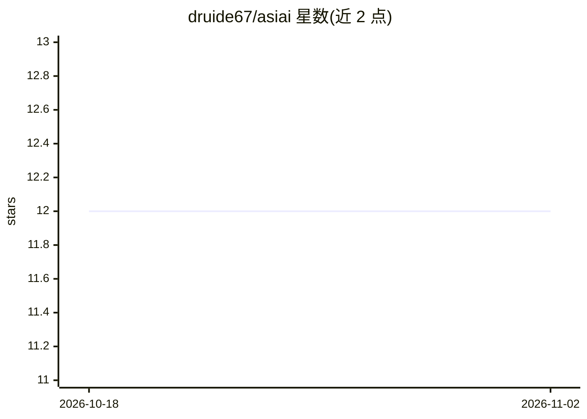

# druide67/asiai

⭐ 12 · Python · Apache-2.0 · 推送 2026-09-15 · [GitHub](https://github.com/druide67/asiai) · 个人维护

**Apple Silicon 多推理引擎 LLM 基准测试与监控 CLI**

面向 Mac（Apple Silicon）用户的命令行工具：在同一模型上跨多个本地推理引擎（Ollama、LM Studio、mlx-lm、llama.cpp 等 9 种）运行标准化基准，报告 tok/s、TTFT、功耗与能效，并对引擎稳定性分类。提供确定性质量模式（工具调用可靠性、指令遵循、语言保持）、前缀缓存复用测量、系统监控（SQLite 存储 + launchd 守护进程）、Web 仪表盘、多机 fleet 管理与 MCP 服务器（14 工具）。社区功能含结果分享、排行榜与按硬件的引擎推荐。经 pipx/brew/pip 安装，Web 与 TUI 为可选额外依赖。

## 筛选速览

| 维度 | 判定 | 备注 |
|---|---|---|
| AI 角色 | `ai-ecosystem` | LLM/agent 周边工具 |
| 许可风险 | `permissive` | Apache-2.0 |
| 部署形态 | `library` | 以包/库形式分发 |
| 模型依赖 | local-ok | 支持本地模型 |
| 硬件要求 | — | 无带数字的原话,不猜 |
| 安装摩擦 | `low` | 无编译、无系统依赖或容器化 |
| 成熟度 | — | 结构信号不足 |

## 能力要点

- 跨 9 种本地推理引擎的标准化基准（tok/s/TTFT/功耗/能效）
- 确定性质量模式：工具调用有效性、IFEval 式指令遵循、语言保持
- 系统与推理监控：SQLite 存储、launchd 守护进程、Web 仪表盘
- MCP 服务器（14 工具）供 Claude Code/Cursor 等 AI agent 接入

## 适用场景

- 在我的 Mac 上对比 Ollama 与 LM Studio 谁跑同一模型更快
- 监控多台 Mac 组成的本地推理集群状态
- 生成可分享的基准测试卡片并与社区结果对比

## 场景标签

`模型评测` `LLM 可观测性` · 领域:评测与运维

## 证据(README 行号)

> L21: **asiai** compares inference engines side-by-side on your Mac. Load the same model on Ollama and LM Studio, run `as
> L358: |Engine|Port|Install|API|

## 星数曲线

2026-10-18 12 → 2026-11-02 12（+0）

---
*卡片 v1 · prompt 1.4 · 生成 2026-11-01 · 置信度 high · 依据 README sha `17c967e1593f` · [字段定义](../../DATASET.md)*
