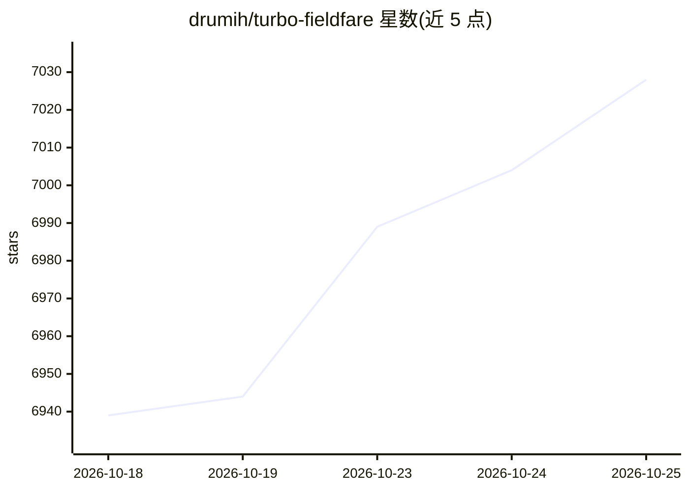

# drumih/turbo-fieldfare

⭐ 7,028 · Swift · Apache-2.0 · 推送 2026-10-15 · [GitHub](https://github.com/drumih/turbo-fieldfare) · 个人维护

**让 8GB Mac 以约 2GB 内存运行 Gemma 4 26B 的 Swift+Metal 推理运行时**

面向 Apple Silicon Mac 的模型专用推理运行时，用 Swift 与 Metal 实现，运行指令微调的 Gemma 4 26B-A4B：内存中只保留 1.35GB 共享核心与 FP16 KV cache，逐 token 从 SSD 流式读取所需专家，从而在 8GB 内存的 Mac 上运行完整模型。提供原生 Mac 应用、CLI 与实验性 OpenAI 兼容回环服务器三种使用形式；模型安装器从 Hugging Face 固定版本流式下载约 15GB 并重打包为 .gturbo 格式。限制：仅 arm64、需 macOS 26 与 Metal 4，非 MLX/llama.cpp 封装；音频视频不支持，视觉需可选约 1.1GB 伴侣包且要求 M2 及以上。

## 筛选速览

| 维度 | 判定 | 备注 |
|---|---|---|
| AI 角色 | `ai-ecosystem` | LLM/agent 周边工具 |
| 许可风险 | `permissive` | Apache-2.0 |
| 部署形态 | `None` |  |
| 模型依赖 | — | README 未给出锁定关系 |
| 硬件要求 | — | 无带数字的原话,不猜 |
| 安装摩擦 | `low` | 无编译、无系统依赖或容器化 |
| 成熟度 | — | 结构信号不足 |

## 能力要点

- 共享核心常驻内存 + 专家从 SSD 流式读取，8GB Mac 可跑 26B 模型
- 同一 .gturbo 模型目录支撑 Mac 应用、CLI 与 OpenAI 兼容回环服务器
- 流式安装器从 Hugging Face 下载并校验哈希，不落盘完整 checkpoint
- 可选视觉伴侣包（约 1.1GB）为应用/CLI/服务器增加图像输入

## 适用场景

- 在小内存 MacBook 上本地运行 Gemma 4 26B 指令模型
- 通过 CLI 或 Mac 应用进行本地对话与图像问答
- 用 OpenAI 兼容接口在本机调用该模型做开发调试

## 场景标签

`推理引擎` · 领域:训练与推理

## 证据(README 行号)

> L6:  A custom Swift + Metal runtime for any Apple Silicon Mac, even the 8 GB ones.
> L33: and Metal. TurboFieldfare is model-specific rather than a wrapper around MLX or

## 星数曲线

2026-10-18 6,939 → 2026-10-25 7,028（+89）

---
*卡片 v1 · prompt 1.4 · 生成 2026-10-20 · 置信度 high · 依据 README sha `9fb6a3109ec0` · [字段定义](../../DATASET.md)*
