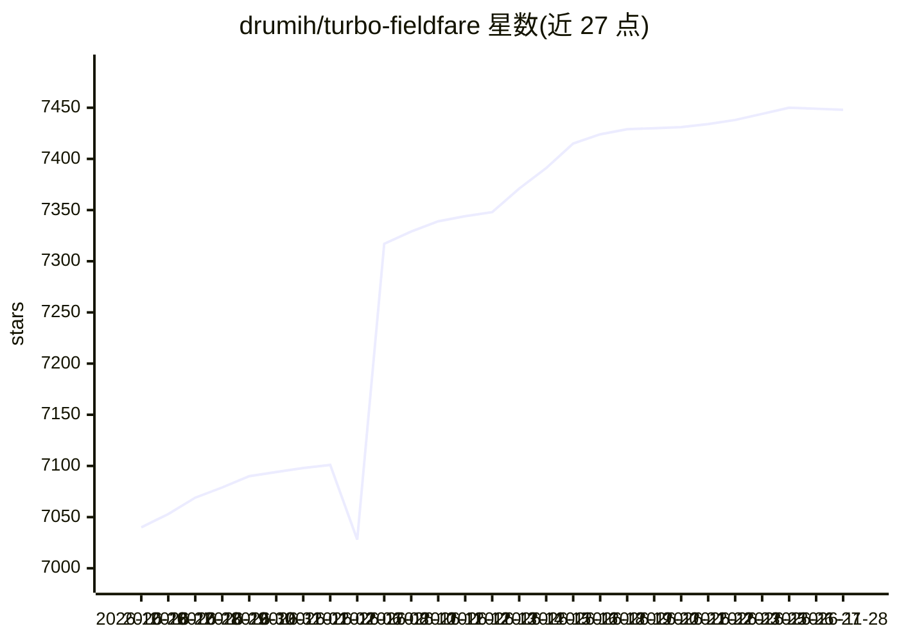

# drumih/turbo-fieldfare

⭐ 7,448 · Swift · Apache-2.0 · 推送 2026-11-24 · [GitHub](https://github.com/drumih/turbo-fieldfare) · 个人维护

**让 8GB M 系列 MacBook 在约 2GB 内存运行 Gemma 4 26B 的本地推理运行时**

用 Swift + Metal 编写的针对 Gemma 4 26B-A4B 的本地推理运行时：常驻约 1.35GB 共享核心与 FP16 KV cache，按 token 从 SSD 流式读取所需专家权重，从而在 8GB 内存的 Apple Silicon Mac 上运行 14.3GB 模型。提供 Swift 库、Mac 应用、CLI、OpenAI 兼容回环服务器和流式安装器五种产物；模型通过 Hugging Face 范围请求流式下载并重打包为 .gturbo 目录，含哈希校验。可选视觉包在 M2 及以上机型支持图片输入；不支持音视频。

## 筛选速览

| 维度 | 判定 | 备注 |
|---|---|---|
| AI 角色 | `ai-native` | 本体是模型或模型工具 |
| 许可风险 | `permissive` | Apache-2.0 |
| 部署形态 | `None` |  |
| 模型依赖 | — | README 未给出锁定关系 |
| 硬件要求 | — | 无带数字的原话,不猜 |
| 安装摩擦 | `low` | 无编译、无系统依赖或容器化 |
| 成熟度 | — | 结构信号不足 |

## 能力要点

- 专家权重按需从 SSD 流式读取，权重+4K KV cache 常驻约 2GB 内存
- 流式安装器从 Hugging Face 按字节范围下载并重打包，不落地完整 checkpoint
- 同一 .gturbo 目录支持 Mac 应用、CLI 与回环 OpenAI 兼容服务器
- 可选视觉包（约 1.1GB）为应用/CLI/服务器增加图片输入

## 适用场景

- 在 8GB 内存 MacBook 上本地运行 Gemma 4 26B-A4B 做指令对话
- 通过回环 OpenAI 兼容接口把本地模型接入现有客户端
- 用 CLI 做可配置采样参数的命令行文本生成

## 场景标签

`推理引擎` · 领域:训练与推理

## 证据(README 行号)

> L25: TurboFieldfare runs the instruction-tuned
> L77: TurboFieldfare provides a native Mac app, a command-line interface, and an
> L85: |`TurboFieldfare`|Swift library containing the runtime and Metal kernels|

## 星数曲线

2026-10-26 7,040 → 2026-11-28 7,448（+408）

---
*卡片 v1 · prompt 1.4 · 生成 2026-11-22 · 置信度 high · 依据 README sha `adf22b9bdc1c` · [字段定义](../../DATASET.md)*
