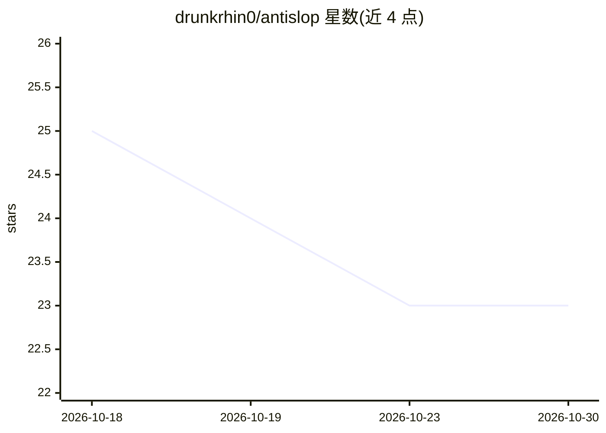

# drunkrhin0/antislop

⭐ 23 · Python · MIT · 推送 2026-09-17 · [GitHub](https://github.com/drunkrhin0/antislop) · 个人维护

**让 AI agent 写出少套话文本的两个技能包**

面向 Claude 类 agent 的 SKILL.md 技能包，含两个技能：antislop 负责写作、编辑与审计散文文本，激活于处理文本任务时；generate-slop 按名调用，生成刻意套路化的演示样本。审计输出原文摘录、规则 ID 与套路化写作风险分（0-100，四档），分数仅衡量文本模式，不能证明或否定 AI 作者身份。v3 规则库从 146 条扩至 222 条，含 5 种写作画像，改写时保护事实、引用、链接、代码与作者声音。提供 npm CLI、zip 包与 ChatGPT/Codex/Kiro 插件包安装方式。

## 筛选速览

| 维度 | 判定 | 备注 |
|---|---|---|
| AI 角色 | `ai-native` | 本体是模型或模型工具 |
| 许可风险 | `permissive` | MIT |
| 部署形态 | `library` | 以包/库形式分发 |
| 模型依赖 | — | README 未给出锁定关系 |
| 硬件要求 | — | 无带数字的原话,不猜 |
| 安装摩擦 | `low` | 无编译、无系统依赖或容器化 |
| 成熟度 | — | 结构信号不足 |

## 能力要点

- 审计返回原文摘录、规则 ID 与 Formulaic Writing Risk Score（四档）
- 222 条规则、5 种写作画像，改写时保护事实/引用/术语/声音
- generate-slop 生成刻意套路化样本供演示与测试

## 适用场景

- 让 agent 改写文案时保留版本号、兼容警告等事实不变
- 审计文本的套路化写作模式而不改写
- 生成套路化样本测试审计效果

## 场景标签

`AI 写作` · 领域:内容生成

## 证据(README 行号)

> L7: - **`antislop`** writes, edits, reviews, and audits prose. It activates when you ask an agent to work on a prose art
> L42: Audits return exact excerpts, rule IDs, and a Formulaic Writing Risk Score:
> L49: The score measures patterns in the text. It cannot prove or disprove AI authorship. Use `generate-slop` only for sy

## 星数曲线

2026-10-18 25 → 2026-10-30 23（-2）

---
*卡片 v1 · prompt 1.4 · 生成 2026-10-27 · 置信度 high · 依据 README sha `c1fa2328292e` · [字段定义](../../DATASET.md)*
