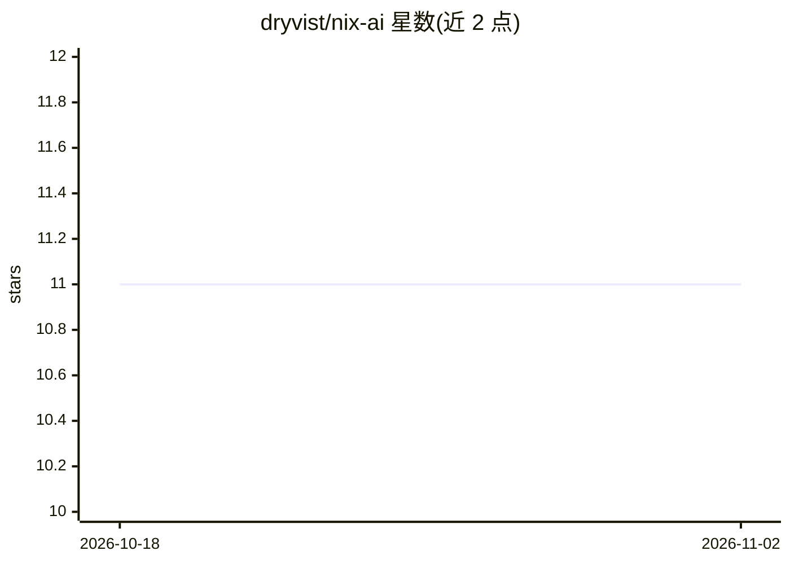

# dryvist/nix-ai

⭐ 11 · Nix · MIT · 推送 2026-11-01 · [GitHub](https://github.com/dryvist/nix-ai) · 个人维护

**用 Nix 声明式管理整套 AI 编程工具链的 home-manager 模块集**

以 Nix flake 形式提供的 home-manager 模块集合，将 Claude Code、Gemini/Antigravity、GitHub Copilot、OpenAI Codex、Qwen Code 等 AI 编程 CLI 的配置、插件、权限规则及 15+ MCP 服务器目录统一为代码管理，一条命令可在不同机器上复现整套环境。支持按工具拆分导入模块，macOS 上可配置 MLX 本地推理（mlx_lm.server + llama-swap + launchd）。要求 Nix flakes、home-manager，平台限 aarch64-darwin 与 x86_64-linux。

## 筛选速览

| 维度 | 判定 | 备注 |
|---|---|---|
| AI 角色 | `ai-ecosystem` | LLM/agent 周边工具 |
| 许可风险 | `permissive` | MIT |
| 部署形态 | `None` |  |
| 模型依赖 | — | README 未给出锁定关系 |
| 硬件要求 | — | 无带数字的原话,不猜 |
| 安装摩擦 | `low` | 无编译、无系统依赖或容器化 |
| 成熟度 | — | 结构信号不足 |

## 能力要点

- 一个 flake 管理多个 AI 编程 CLI 的配置、插件与权限规则
- MCP 服务器目录统一配置并分发到各 agent
- 可按工具粒度拆分导入模块（claude/codex/mcp 等）
- macOS 上经 mlx_lm.server + llama-swap 提供本地 MLX 推理

## 适用场景

- 在多台机器间复现同一套 AI 编程工具配置
- 统一声明式管理 Claude Code / Copilot / Codex 等工具与 MCP 服务器
- 在 Apple Silicon 上启用本地 MLX 模型推理服务

## 场景标签

 · 领域:开发者工具/AI 环境管理

## 证据(README 行号)

> L24: |**MCP Servers**|One catalog (GitHub, Terraform, Context7, filesystem, memory, …) fanned out to every agent|
> L63: nix-ai exports home-manager modules

## 星数曲线

2026-10-18 11 → 2026-11-02 11（+0）

---
*卡片 v1 · prompt 1.4 · 生成 2026-11-02 · 置信度 high · 依据 README sha `bab59edb3b59` · [字段定义](../../DATASET.md)*
