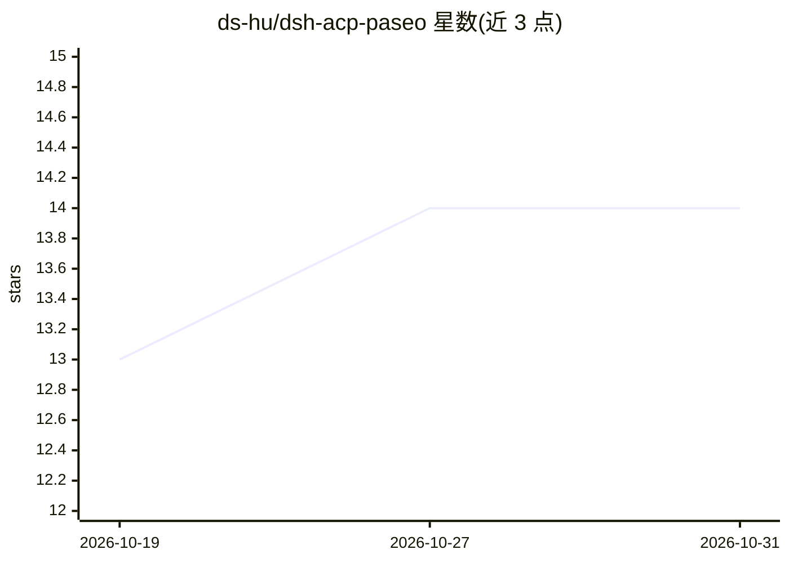

# ds-hu/dsh-acp-paseo

⭐ 14 · TypeScript · MIT · 推送 2026-10-19 · [GitHub](https://github.com/ds-hu/dsh-acp-paseo) · 个人维护 · 中文 README

**将 DeepSeek Harness 接入 Paseo 的 ACP 插件**

基于 Agent Client Protocol 的 Paseo 插件，把 DeepSeek Harness（DSH）作为 agent provider 接入 Paseo：提供逐 token 实时流式输出与停止控制、从 DSH Profile 自动发现并动态切换模型、新建任务时选择 DSH 预设（Standard/PTC/Minimal/Creator）、跨 Profile 会话持久化（写入 DSH 全局会话库，与 DSH Web/TUI 共享）、原生交互式提问卡片与单次工具审批，并兼容 Paseo MCP 工具链。安装需先在 DSH acp-plus Profile 添加 @ds-hu/dsh-acp-plus 包，再经 npm 安装本插件并配置 config.json。

## 筛选速览

| 维度 | 判定 | 备注 |
|---|---|---|
| AI 角色 | `ai-ecosystem` | LLM/agent 周边工具 |
| 许可风险 | `permissive` | MIT |
| 部署形态 | `None` |  |
| 模型依赖 | locked-api |  |
| 硬件要求 | — | 无带数字的原话,不猜 |
| 安装摩擦 | `low` | 无编译、无系统依赖或容器化 |
| 成熟度 | — | 结构信号不足 |

## 能力要点

- 逐 token 实时流式输出与思考过程展示，含即时停止按钮
- 自动发现 DSH Profile 中的模型并支持界面内切换模型、审批策略、沙箱隔离
- 会话写入 DSH 全局会话库，跨 Profile 与 DSH Web/TUI 共享
- 原生交互式提问卡片与单次（Allow once）工具审批，兼容 Paseo MCP

## 适用场景

- 在 Paseo 界面中使用 DeepSeek Harness 作为编码 agent
- 跨设备/Profile 恢复与共享 DSH 会话
- 通过原生卡片回答 agent 提问并按次审批敏感操作

## 场景标签

`编码 Agent` · 领域:编码与开发

## 证据(README 行号)

> L3: **DeepSeek Harness in Paseo.** Connect DeepSeek Harness to Paseo with real-time token streaming, in-app DSH preset s
> L69:    "deepseek-harness": { "command": ["dsh", "--profile", "acp-plus"] }

## 星数曲线

2026-10-19 13 → 2026-10-31 14（+1）

---
*卡片 v1 · prompt 1.4 · 生成 2026-10-31 · 置信度 high · 依据 README sha `580cc40a12bb` · [字段定义](../../DATASET.md)*
