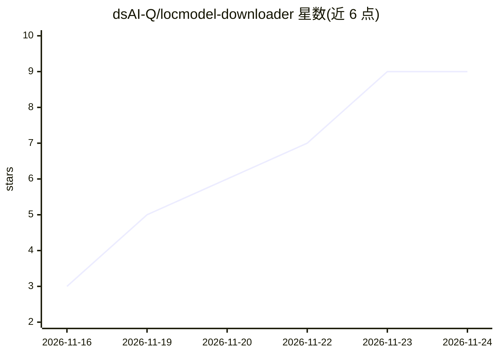

# dsAI-Q/locmodel-downloader

⭐ 9 · C# · NOASSERTION · 推送 2026-11-23 · [GitHub](https://github.com/dsAI-Q/locmodel-downloader) · 个人维护 · 中文 README

**给 LocModel 等本地模型运行器用的三站模型下载器（Windows）**

Windows 下的模型下载工具，从 HuggingFace、魔搭 ModelScope、Civitai 三站下载模型文件，全部经 aria2c 多线程下载，支持断点续传、批量队列、粘链接自动识别来源、下载后大小/sha256 校验、接管 LocModel 未完成的 .part 文件。勾选 .gguf 时自动带上 mmproj 与多分片，图片/视频模型按「主体+文本编码器+VAE」配方一次下齐。便携解压即用，无需管理员权限；也支持命令行自检与源码构建。

## 筛选速览

| 维度 | 判定 | 备注 |
|---|---|---|
| AI 角色 | `ai-ecosystem` | LLM/agent 周边工具 |
| 许可风险 | `none` | NOASSERTION |
| 部署形态 | `desktop` | 安装包/桌面程序 |
| 模型依赖 | — | README 未给出锁定关系 |
| 硬件要求 | — | 无带数字的原话,不猜 |
| 安装摩擦 | `low` | 无编译、无系统依赖或容器化 |
| 成熟度 | — | 结构信号不足 |

## 能力要点

- HuggingFace / ModelScope / Civitai 三来源混队下载，粘链接自动识别来源
- aria2c 多线程、断点续传、批量队列与下载后 sha256 校验
- 自动配齐 .gguf 的 mmproj 与分片；图片/视频模型三件套配方下载
- 便携解压即用，可自动下载安装 aria2c 引擎

## 适用场景

- 为 LocModel 批量下载 LLM 与图片/视频模型
- 从 Civitai 或 HF 镜像下载模型并校验文件完整性
- 接管 LocModel 未完成的 .part 半成品下载

## 场景标签

 · 领域:LLM基础设施/模型获取工具

## 证据(README 行号)

> L3: 给 LocModel 这类本地模型运行器配的模型下载工具（Windows）。可以同时从 **HuggingFace、魔塔 ModelScope、C站 Civitai** 三站下载，全部走 `aria2c` 多线程，支持断点续传、批量
> L21: - **不只给 LocModel 用**：主界面可以勾选任意文件；队列里 `repo :: *` 下载整个仓库（不限扩展名），ComfyUI 等工具的模型也能用它下；下载目录可改成任意路径
> L30: - .NET Framework 4.x（系统自带，不用装）

## 星数曲线

2026-11-16 3 → 2026-11-24 9（+6）

---
*卡片 v1 · prompt 1.4 · 生成 2026-11-20 · 置信度 high · 依据 README sha `dfdc45329407` · [字段定义](../../DATASET.md)*
