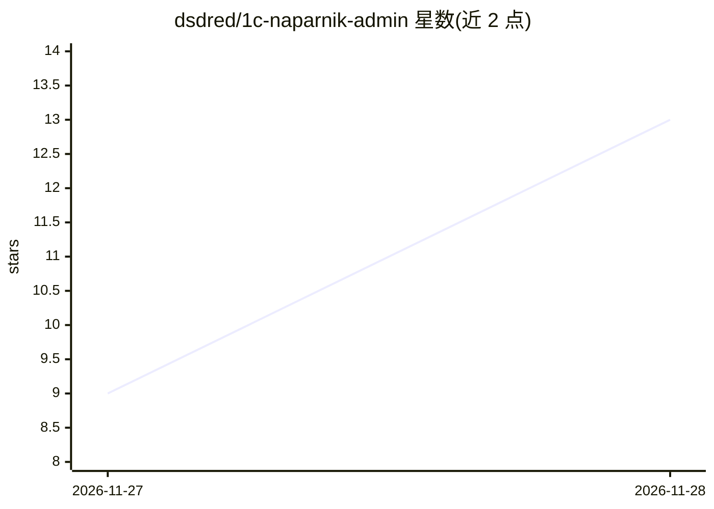

# dsdred/1c-naparnik-admin

⭐ 13 · Go · 推送 2026-11-27 · [GitHub](https://github.com/dsdred/1c-naparnik-admin) · 个人维护

**给 1С:Напарник 提供 OpenAI/Anthropic/Gemini 兼容网关与管理面板**

面向 1С:Напарник 开发助手 API 的 HTTP 网关与 Web 管理面板：接收 OpenAI Chat Completions/Responses、Anthropic Messages、Gemini 等格式的请求，转换为 Напарник API 并按客户端格式返回，使 Cline、Claude Code、Gemini CLI 等 IDE 与 agent 工具可接入。提供单键多令牌发放（AES-GCM 加密、哈希存储）、配额监控与 webhook 告警、请求日志（CSV 导出）、多监听端口与 HTTPS、连接配置向导。Go 单二进制，SQLite 内置，前端经 go:embed 打包；仅支持文本，图片与附件被拒绝。

## 筛选速览

| 维度 | 判定 | 备注 |
|---|---|---|
| AI 角色 | `ai-ecosystem` | LLM/agent 周边工具 |
| 许可风险 | `none` | — |
| 部署形态 | `desktop` | 安装包/桌面程序 |
| 模型依赖 | — | README 未给出锁定关系 |
| 硬件要求 | — | 无带数字的原话,不猜 |
| 安装摩擦 | `low` | 无编译、无系统依赖或容器化 |
| 成熟度 | — | 结构信号不足 |

## 能力要点

- OpenAI/Anthropic/Gemini 三类协议在同一端口接收并转换到 Напарник API
- 单键发放多 IDE 令牌，键 AES-GCM 加密、令牌仅存哈希
- 配额监控：5 小时/周窗口用量图表、剩余请求估算、阈值 webhook 告警
- Windows 服务直装 SCM、多监听器、可切换 HTTPS（TLS 1.2+）

## 适用场景

- 让团队多个 IDE 通过各自令牌共享一个 Напарник 键
- 为 Cline/Claude Code/Gemini CLI 生成即拷即用的连接配置
- 按密钥追踪配额消耗并设置告警
- 以 CSV 审计请求记录并按保留天数清理

## 场景标签

`模型网关` · 领域:Agent 开发

## 证据(README 行号)

> L5: Шлюз и админка для публичного API **«1С:Напарник разработчика»**. Подключает Напарника к любым современным IDE и аге
> L15: |OpenAI Chat Completions|`POST /v1/chat/completions`, `GET /v1/models`|Cline, Roo Code, Continue, Zed, JetBrains AI

## 星数曲线

2026-11-27 9 → 2026-11-28 13（+4）

---
*卡片 v1 · prompt 1.4 · 生成 2026-11-27 · 置信度 high · 依据 README sha `ebe4cfd139f1` · [字段定义](../../DATASET.md)*
