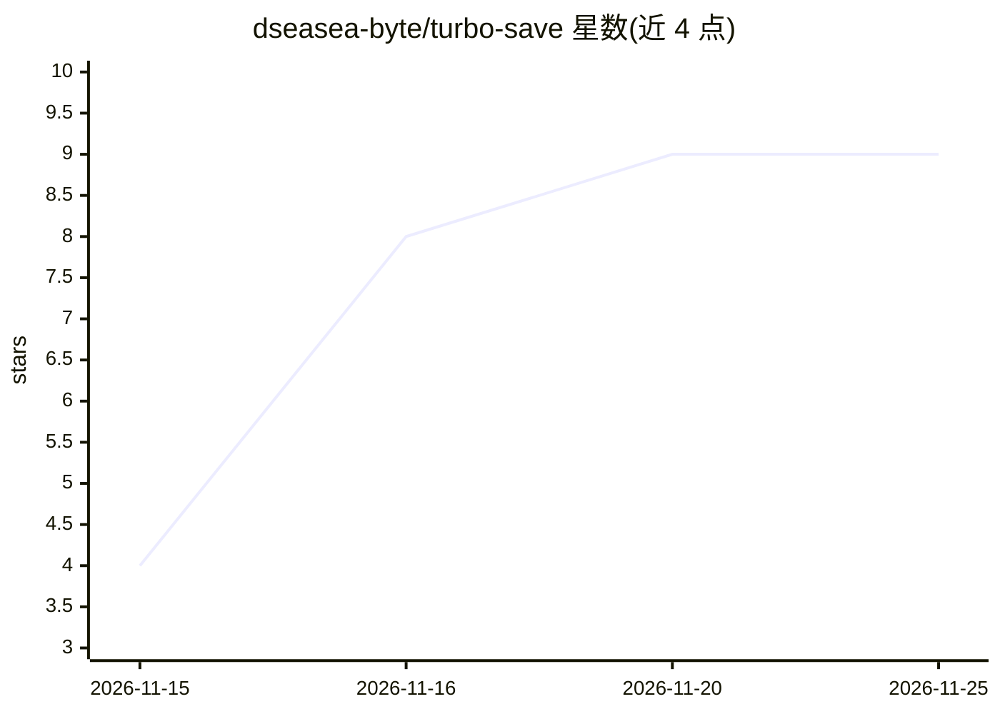

# dseasea-byte/turbo-save

⭐ 9 · MIT · 推送 2026-11-12 · [GitHub](https://github.com/dseasea-byte/turbo-save) · 个人维护 · 中文 README

**批量任务拆分给低成本模型并行执行、降本提速的 Agent 技能**

以 SKILL.md 形式分发的 Agent 技能，定义一套批量任务的拆分决策流程：强模型负责规划与验收，执行层降档到最便宜的可选模型并按批并行。内含三道门禁（规模门槛、可判性、可切分性），不满足条件则不拆；降档前须先写出机器可验证的验收标准；返工只重跑失败项。跨 Agent 通用，不依赖特定工具名或模型名，结束输出执行档位与节省来源的报账。作者声明收益相对当前会话所选模型，已在最低档时收益趋近于零。

## 筛选速览

| 维度 | 判定 | 备注 |
|---|---|---|
| AI 角色 | `ai-knowledge` | 知识聚合/清单类 |
| 许可风险 | `permissive` | MIT |
| 部署形态 | `None` |  |
| 模型依赖 | — | README 未给出锁定关系 |
| 硬件要求 | — | 无带数字的原话,不猜 |
| 安装摩擦 | `low` | 无编译、无系统依赖或容器化 |
| 成熟度 | — | 结构信号不足 |

## 能力要点

- 强模型规划验收 + 低成本模型并行执行的双层拆分流程
- 三道门禁（规模/可判性/可切分性）防止拆错亏本
- 定点打回，仅重跑失败项而非整批重跑
- 手动安装方式覆盖 Claude Code、Cursor、Codex、Gemini CLI 等技能目录

## 适用场景

- 批量改写、逐条检查、字段提取等可重复任务降本执行
- 大批量生成时隔离上下文，主线程只收摘要
- 在多模型可用时选择执行层降档策略

## 场景标签

`提示工程` · 领域:Agent 开发

## 证据(README 行号)

> L3: > 省成本且提速的批量任务分发工作流。把批量任务拆成「强模型规划 + 低成本模型并行执行」。
> L6: Agent Skills
> L96: ├── SKILL.md      # 技能定义与全部判据（Agent 读取此文件）

## 星数曲线

2026-11-15 4 → 2026-11-25 9（+5）

---
*卡片 v1 · prompt 1.4 · 生成 2026-11-20 · 置信度 high · 依据 README sha `3d7ab511b015` · [字段定义](../../DATASET.md)*
