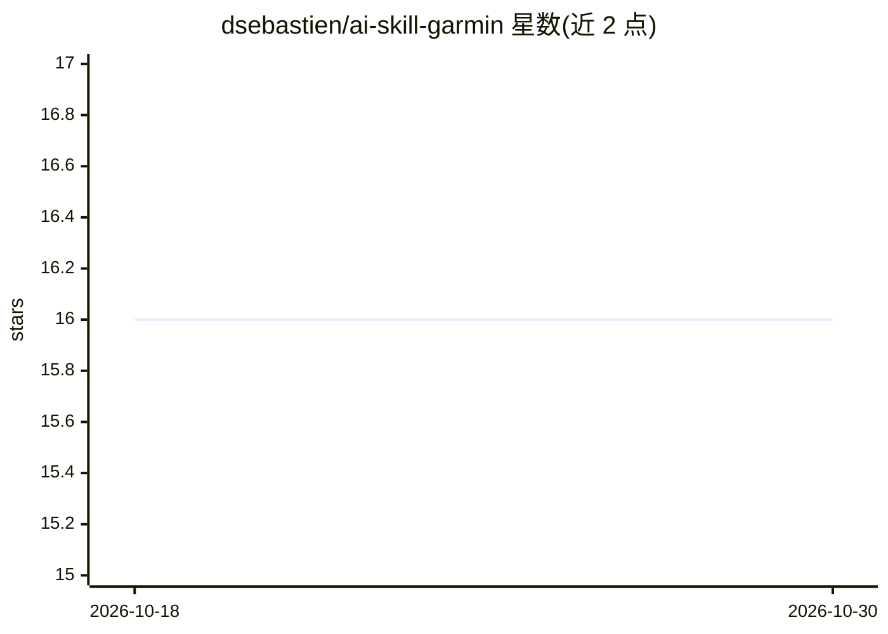

# dsebastien/ai-skill-garmin

⭐ 16 · TypeScript · MIT · 推送 2026-04-16 · [GitHub](https://github.com/dsebastien/ai-skill-garmin) · 个人维护

**Agent Skill：用自然语言查询 Garmin 手表健康数据**

连接 Garmin Connect 的 Agent Skill，让任意兼容 agentskills.io 标准的 agent（Claude、Cursor、Gemini CLI 等）以自然语言查询步数、睡眠、HRV、心率、身体电量、训练准备度与运动记录。自包含移植 2026 年 3 月移动端 JSON 登录流程，零 npm 依赖，单 TypeScript 文件经 Bun 运行；也提供 CLI 可脱离 agent 直接使用。凭证经环境变量传入，令牌缓存于本地（0600）。限制：Garmin 无公开稳定 API，端点轮换可能导致 401/404/429 需手工修补；短信/App MFA 需扩展支持。

## 筛选速览

| 维度 | 判定 | 备注 |
|---|---|---|
| AI 角色 | `ai-ecosystem` | LLM/agent 周边工具 |
| 许可风险 | `permissive` | MIT |
| 部署形态 | `library` | 以包/库形式分发 |
| 模型依赖 | — | README 未给出锁定关系 |
| 硬件要求 | — | 无带数字的原话,不猜 |
| 安装摩擦 | `low` | 无编译、无系统依赖或容器化 |
| 成熟度 | — | 结构信号不足 |

## 能力要点

- 零 npm 依赖，单 TypeScript 文件经 Bun 运行
- 12 个 CLI 子命令输出 JSON（daily/sleep/hrv/readiness/activities 等）
- 兼容任何 agentskills.io 兼容 agent，亦可脱离 agent 直接运行
- 令牌本地缓存（0600），OAuth2 bearer 静默刷新

## 适用场景

- 通过对话询问昨晚睡眠或本周训练数据
- 让 agent 代查步数、静息心率趋势与运动记录
- 脚本化拉取 Garmin 数据的 JSON 输出

## 场景标签

`数据分析` · 领域:效率与自动化

## 证据(README 行号)

> L3: An Agent Skill that connects to Garmin Connect and lets you query your watch data in natural language. Works with an
> L17: Garmin has no stable public API, and the community libraries (garth, python-garminconnect) break every few months w

## 星数曲线

2026-10-18 16 → 2026-10-30 16（+0）

---
*卡片 v1 · prompt 1.4 · 生成 2026-10-30 · 置信度 high · 依据 README sha `f2da3715b51f` · [字段定义](../../DATASET.md)*
