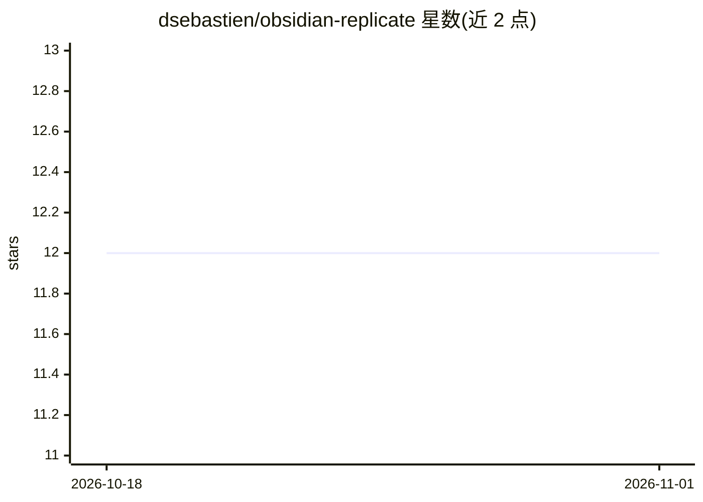

# dsebastien/obsidian-replicate

⭐ 12 · TypeScript · MIT · 推送 2026-10-14 · [GitHub](https://github.com/dsebastien/obsidian-replicate) · [官网](https://dsebastien.github.io/obsidian-replicate/) · 个人维护

**在 Obsidian 中调用 Replicate 模型生成图像的插件**

Obsidian 社区插件，接入 Replicate.com API：从选中文本或弹窗输入 prompt，调用 Replicate 上支持的图像生成模型（如 Stable Diffusion、FLUX.1）生成图像，可将输出 URL 复制到剪贴板或以 markdown 嵌入追加到当前笔记。模型以 <owner>/<name> 形式配置，支持自由 JSON input，需 Replicate 账号与 API token。API 密钥存于 Obsidian 密钥存储而非 vault；生成的图像在 Replicate 服务器仅保留一小时。提供社区插件目录、手动安装与 BRAT 三种安装方式。

## 筛选速览

| 维度 | 判定 | 备注 |
|---|---|---|
| AI 角色 | `ai-enhanced` | 去掉 AI 部分产品仍成立 |
| 许可风险 | `permissive` | MIT |
| 部署形态 | `None` |  |
| 模型依赖 | — | README 未给出锁定关系 |
| 硬件要求 | — | 无带数字的原话,不猜 |
| 安装摩擦 | `low` | 无编译、无系统依赖或容器化 |
| 成熟度 | — | 结构信号不足 |

## 能力要点

- 从选中文本或弹窗 prompt 生成图像，支持任意接受 prompt 的 Replicate 模型
- 输出 URL 可复制到剪贴板或以 markdown 图像嵌入追加到笔记
- API token 存于 Obsidian secret storage，仅联系 Replicate.com，无遥测
- 支持社区插件目录、手动文件复制与 BRAT beta 三种安装途径

## 适用场景

- 在笔记中直接为选中文本配图
- 用 Replicate 上的 Stable Diffusion / FLUX.1 等模型生图并嵌入笔记
- 写作时以命令面板或右键菜单快速生成插图

## 场景标签

`图像生成` · 领域:内容生成

## 证据(README 行号)

> L3: Obsidian plugin that integrates Replicate.com and enables using the various image generation models supported by Rep
> L11: - Generate images from the current selection or from a prompt entered in a modal.

## 星数曲线

2026-10-18 12 → 2026-11-01 12（+0）

---
*卡片 v1 · prompt 1.4 · 生成 2026-11-01 · 置信度 high · 依据 README sha `ba758b530ec4` · [字段定义](../../DATASET.md)*
