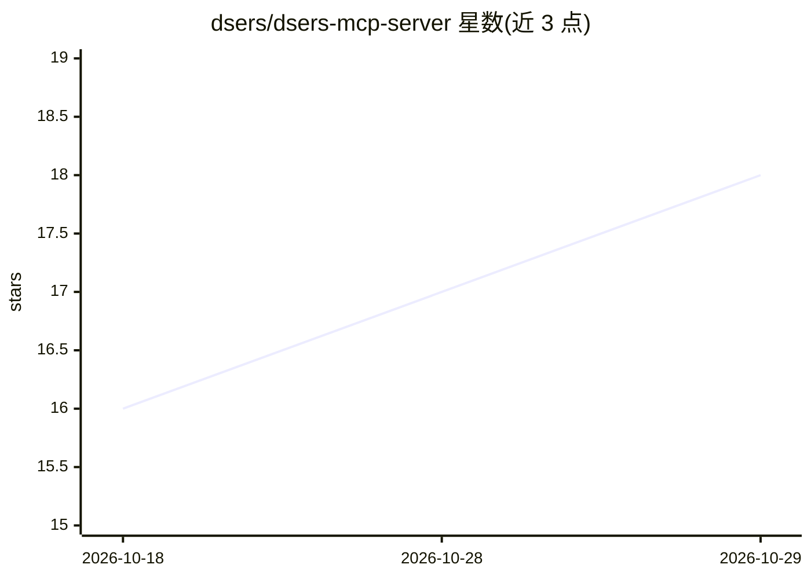

# dsers/dsers-mcp-server

⭐ 18 · Apache-2.0 · 推送 2026-10-26 · [GitHub](https://github.com/dsers/dsers-mcp-server) · [官网](https://smithery.ai/servers/dsers/mcp-server) · 组织维护 · 中文 README

**DSers 官方托管的 MCP 服务器：让 AI 客户端操作代发货工作流**

DSers 官方托管的远程 MCP 服务，本仓库仅含连接信息、用户文档、示例与注册表元数据，不含后端源码。服务通过 https://ai.dsers.com/mcp 以 Streamable HTTP 提供 60 个工具，覆盖账户与计费、店铺连接、供应商与商品搜索、商品发布与 Mapping、订单诊断/支付/履约、包裹追踪与通知等。使用 OAuth 2.1 + PKCE 认证，工具按读/写/危险分级并有安全确认机制；支持 Claude Code、Codex CLI、ChatGPT App 等客户端接入。

## 筛选速览

| 维度 | 判定 | 备注 |
|---|---|---|
| AI 角色 | `ai-ecosystem` | LLM/agent 周边工具 |
| 许可风险 | `permissive` | Apache-2.0 |
| 部署形态 | `None` |  |
| 模型依赖 | — | README 未给出锁定关系 |
| 硬件要求 | — | 无带数字的原话,不猜 |
| 安装摩擦 | `low` | 无编译、无系统依赖或容器化 |
| 成熟度 | — | 结构信号不足 |

## 能力要点

- 远程 MCP 端点暴露 60 个工具（账户、店铺、商品、订单、履约）
- OAuth 2.1 + PKCE 认证，工具按角色与 scope 过滤
- 工具分读/写/危险三级，危险调用需用户显式确认
- 提供 Claude Code / Codex CLI / ChatGPT App 接入配置

## 适用场景

- 在 MCP 客户端中直接搜索供应商商品并发布到店铺
- 通过 AI 客户端诊断、下单、取消与履约订单
- 管理店铺连接、商品 Mapping 与定价规则

## 场景标签

`工作流自动化` · 领域:效率与自动化

## 证据(README 行号)

> L3: Official hosted Model Context Protocol server for operating DSers workflows from AI clients.
> L29: The current service exposes 60 tools grouped around:
> L40: The server advertises tools only. It does not expose MCP prompts, resources, or iframe widgets.

## 星数曲线

2026-10-18 16 → 2026-10-29 18（+2）

---
*卡片 v1 · prompt 1.4 · 生成 2026-10-29 · 置信度 high · 依据 README sha `681fa6433f84` · [字段定义](../../DATASET.md)*
