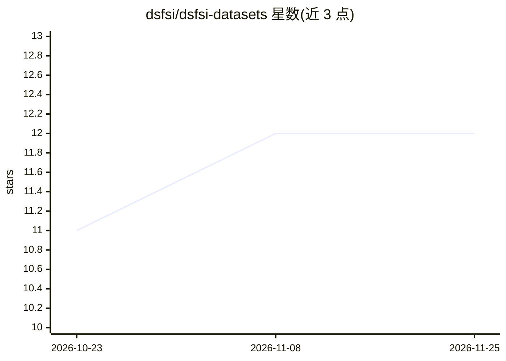

# dsfsi/dsfsi-datasets

⭐ 12 · Jupyter Notebook · MIT · 推送 2025-12-31 · [GitHub](https://github.com/dsfsi/dsfsi-datasets) · [官网](https://www.dsfsi.co.za) · 组织维护

**面向研究者的南非与非洲语言公开数据集登记目录**

比勒陀利亚大学 DSFSI 研究组的官方数据集登记仓库，编目 50+ 个公开数据集，覆盖语音识别、NLP、术语、公共卫生、法律与金融数据，聚焦南非及非洲语言。按类别、语言、平台（HuggingFace/GitHub/Zenodo/大学仓库）三种维度组织条目，并提供 datasets 库加载、git clone 获取、transformers 调用模型等访问示例。仓库本身不含可运行的 AI 产品，本地仅存放小规模教学与金融数据文件。

## 筛选速览

| 维度 | 判定 | 备注 |
|---|---|---|
| AI 角色 | `ai-knowledge` | 知识聚合/清单类 |
| 许可风险 | `permissive` | MIT |
| 部署形态 | `None` |  |
| 模型依赖 | — | README 未给出锁定关系 |
| 硬件要求 | — | 无带数字的原话,不猜 |
| 安装摩擦 | `low` | 无编译、无系统依赖或容器化 |
| 成熟度 | — | 结构信号不足 |

## 能力要点

- 50+ 数据集按类别、语言、平台三种维度编目
- African Next Voices 多语语音数据集（3,000 小时，7 种南非语言）
- 提供 HuggingFace datasets/transformers 访问示例代码
- Zenodo 存档条目附带 DOI 供学术引用

## 适用场景

- 查找祖鲁语、茨瓦纳语等南非语言的语音或文本数据集
- 为低资源语言 NLP 研究收集平行语料
- 课程教学中获取分类与客户分析练习数据

## 场景标签

`精选清单` · 领域:学习与行业

## 证据(README 行号)

> L3: **Official dataset registry for the Data Science for Social Impact (DSFSI) Research Group**
> L11: This repository serves as the comprehensive catalog and registry for all publicly available datasets produced by th

## 星数曲线

2026-10-23 11 → 2026-11-25 12（+1）

---
*卡片 v1 · prompt 1.4 · 生成 2026-11-18 · 置信度 high · 依据 README sha `7418afeaf95b` · [字段定义](../../DATASET.md)*
