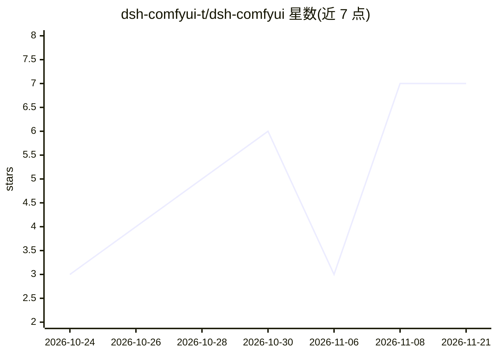

# dsh-comfyui-t/dsh-comfyui

⭐ 7 · JavaScript · MIT · 推送 2026-11-12 · [GitHub](https://github.com/dsh-comfyui-t/dsh-comfyui) · 组织维护 · 中文 README

**DSH 用户的 ComfyUI 绘图面板插件**

面向 DSH（本地 coding-agent harness）用户的插件，把 ComfyUI 接入 DSH Web UI：顶栏提供绘图台面板，含底模/LoRA 多选、提示词词库与中文转标签、预设卡位、角色卡与风格卡（含自训流程技能包）、出图后放大、视角三档与种子控制。安装走 PowerShell 脚本并附 verify.ps1 校验（文件完整性、端口、profile 挂载），8199 端口跑 Python 侧车。要求 DSH≥0.2.0-rc.2、Node≥18、Python≥3.10、ComfyUI 带若干 Loader 节点。

## 筛选速览

| 维度 | 判定 | 备注 |
|---|---|---|
| AI 角色 | `ai-native` | 本体是模型或模型工具 |
| 许可风险 | `permissive` | MIT |
| 部署形态 | `None` |  |
| 模型依赖 | — | README 未给出锁定关系 |
| 硬件要求 | — | 无带数字的原话,不猜 |
| 安装摩擦 | `low` | 无编译、无系统依赖或容器化 |
| 成熟度 | — | 结构信号不足 |

## 能力要点

- 底模/LoRA 多选与角色卡/风格卡双卡机制（skills/comfyui-cards）
- 提示词词库与中文转标签、出图后放大、视角三档、种子控制
- PowerShell 脚本安装并附 verify.ps1 一键校验（端口/版本/卡数/profile）
- SPEC.md 开发规范全部条款可被 tools/check_all.py 机器判定

## 适用场景

- 在 DSH 同一窗口内直接调用 ComfyUI 出图
- 用中文提示词经词库转标签生成图像
- 管理角色卡/风格卡并按预设组合出图后放大

## 场景标签

`图像生成` · 领域:内容生成

## 证据(README 行号)

> L1: # DSH ComfyUI 绘图台
> L3: 把 ComfyUI 变成 DSH 里的一个绘图面板：底模 / LoRA 多选、提示词词库与中文转标签、预设、角色卡与风格卡、出图后放大、视角三档、种子控制，全部在使用 DSH 的同一个窗口里完成。
> L45: |ComfyUI|任意版本，需带 `UNETLoader` / `LoraLoader` / `VAELoader` / `CLIPLoader`|

## 星数曲线

2026-10-24 3 → 2026-11-21 7（+4）

---
*卡片 v1 · prompt 1.4 · 生成 2026-11-20 · 置信度 high · 依据 README sha `d2e709c24e45` · [字段定义](../../DATASET.md)*
