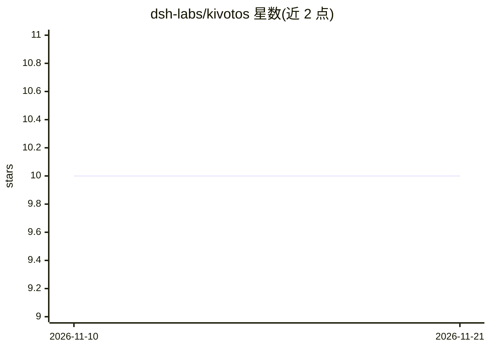

# dsh-labs/kivotos

⭐ 10 · TypeScript · Apache-2.0 · 推送 2026-11-16 · [GitHub](https://github.com/dsh-labs/kivotos) · 组织维护

**跨设备远程访问 dsh 的插件，含手机布局与安卓应用**

Kivotos 是 DeepSeek Harness（dsh）的开源第三方插件：在任意一台机器上打开另一台机器的 dsh 完整界面，包括会话、审批、模型、设置、文件与终端。连接方式支持 Tailscale 或自建中继服务器，中继只转发端到端加密数据；针对手机提供专用布局与安卓应用（支持审批通知直接操作）。可在远程安全重启 dsh，自托管运行，无账号与遥测。要求 dsh 版本 0.2.2-rc.2，远程重启不支持 Windows 与 systemd。

## 筛选速览

| 维度 | 判定 | 备注 |
|---|---|---|
| AI 角色 | `ai-ecosystem` | LLM/agent 周边工具 |
| 许可风险 | `permissive` | Apache-2.0 |
| 部署形态 | `desktop` | 安装包/桌面程序 |
| 模型依赖 | locked-api |  |
| 硬件要求 | — | 无带数字的原话,不猜 |
| 安装摩擦 | `low` | 无编译、无系统依赖或容器化 |
| 成熟度 | — | 结构信号不足 |

## 能力要点

- 从任意设备访问远端机器的 dsh 完整 UI（会话/审批/模型/设置/文件/终端）
- Tailscale 与自建中继两种连接方式，中继仅转发端到端加密数据
- 安卓应用支持审批、提问、任务完成通知及通知内直接允许/拒绝审批
- 会话事件流 permessage-deflate 压缩，远程安全重启机制

## 适用场景

- 在手机上查看和操作家里或服务器上的 dsh 会话
- 通过自建中继安全访问多台机器上的 dsh
- 远程管理 dsh 的审批与任务完成状态

## 场景标签

 · 领域:开发工具/远程访问

## 证据(README 行号)

> L12: Kivotos is an open source plugin for DeepSeek Harness (dsh). Open any of your machines' dsh from any other, with it
> L14: - **All your machines:** Switch between them from the dsh sidebar. What you see is the remote dsh's own UI, so ever

## 星数曲线

2026-11-10 10 → 2026-11-21 10（+0）

---
*卡片 v1 · prompt 1.4 · 生成 2026-11-19 · 置信度 mid · 依据 README sha `67a965ba72f0` · [字段定义](../../DATASET.md)*
