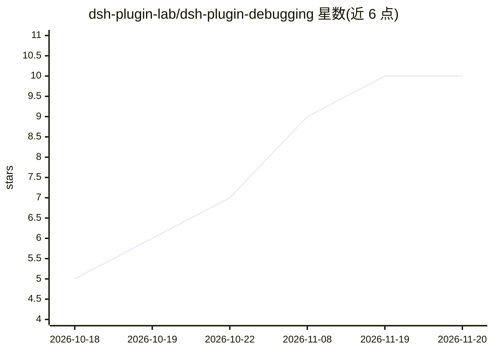

# dsh-plugin-lab/dsh-plugin-debugging

⭐ 10 · TypeScript · MIT · 推送 2026-11-19 · [GitHub](https://github.com/dsh-plugin-lab/dsh-plugin-debugging) · [官网](https://zl-vertex.feishu.cn/wiki/Qj80wE0AriasrNklQrUc43VNnQb) · 组织维护 · 中文 README

**DSH 插件排障工具箱：让 Agent 自检自修运行时**

一个 DSH 插件，安装后为 DSH agent 提供一组工具和一份按需加载的 skill 文档，用于判断插件改动为何未生效：区分配置热加载、宿主代码重启、前端资产热更新三种情况。工具分只读（列出实例、诊断插件加载、检查生效模式、导出配置、签发 cookie）与改动状态（热重载、默认关闭的重启）两类，重启动作需通过三项门控。要求 Node >= 20，支持 Web 与 Desktop 载体，Desktop 下部分工具不可用。

## 筛选速览

| 维度 | 判定 | 备注 |
|---|---|---|
| AI 角色 | `ai-ecosystem` | LLM/agent 周边工具 |
| 许可风险 | `permissive` | MIT |
| 部署形态 | `library` | 以包/库形式分发 |
| 模型依赖 | — | README 未给出锁定关系 |
| 硬件要求 | — | 无带数字的原话,不猜 |
| 安装摩擦 | `low` | 无编译、无系统依赖或容器化 |
| 成熟度 | — | 结构信号不足 |

## 能力要点

- 8 个排障工具，分只读与改动状态两类，附 Web/Desktop 可用性标记
- dsh_restart 默认关闭，需通过四项检查、审批策略、marker 写入三重门控
- skill 文档为推理依据，与工具输出冲突时以 skill 文档为准
- 测试强制约束：除自身命名空间外禁止写宿主数据路径

## 适用场景

- 排查插件改动未生效的原因（热加载/重启/刷新）
- 让 agent 诊断插件是否真正加载进 DSH 宿主
- 为脚本或浏览器自动化签发访问本地 DSH 实例的 cookie

## 场景标签

 · 领域:开发者工具/agent 基础设施

## 证据(README 行号)

> L5:  dsh-plugin-debugging: letting a DSH agent inspect and fix its own runtime
> L31: After installation, the agent gains a set of tools and a skill document. The skill loads on demand; you invoke it w
> L98: Node `>= 20`, and a DSH version that satisfies the range in package.json.

## 星数曲线

2026-10-18 5 → 2026-11-20 10（+5）

---
*卡片 v1 · prompt 1.4 · 生成 2026-11-19 · 置信度 high · 依据 README sha `3d47bd3f7d92` · [字段定义](../../DATASET.md)*
