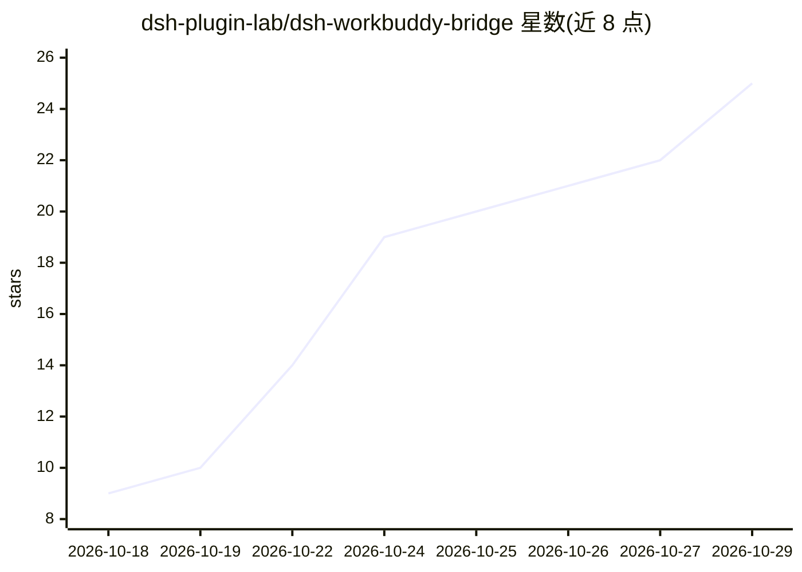

# dsh-plugin-lab/dsh-workbuddy-bridge

⭐ 25 · TypeScript · MIT · 推送 2026-10-26 · [GitHub](https://github.com/dsh-plugin-lab/dsh-workbuddy-bridge) · [官网](https://www.npmjs.com/package/dsh-workbuddy-bridge) · 组织维护 · 中文 README

**DSH 插件：把 WorkBuddy 桌面 App 的模型接入 DeepSeek Harness**

面向 DeepSeek Harness（DSH）的插件：读取 WorkBuddy 桌面 App（国内版 WorkBuddy / 国际版 WorkBuddy AI）本机登录状态，将其模型以分组形式接入 DSH 模型选择器，账号与积分互不混用，凭据仅在本机留存加密副本。功能含推理档位选择与手动检测、积分余额显示、模型显隐、图片输入。安装前提是已装并登录 WorkBuddy App；仅供个人学习研究使用，不得商用。

## 筛选速览

| 维度 | 判定 | 备注 |
|---|---|---|
| AI 角色 | `ai-ecosystem` | LLM/agent 周边工具 |
| 许可风险 | `permissive` | MIT |
| 部署形态 | `library` | 以包/库形式分发 |
| 模型依赖 | locked-api |  |
| 硬件要求 | — | 无带数字的原话,不猜 |
| 安装摩擦 | `low` | 无编译、无系统依赖或容器化 |
| 成熟度 | — | 结构信号不足 |

## 能力要点

- 复用 WorkBuddy 桌面 App 登录状态，凭据不出本机
- 国内版/国际版双 App 分组隔离，各自账号与积分
- 推理档位可选与手动检测（上游接口档位信息不可靠时逐模型确认）
- 回复下方显示消耗积分与模型选择器旁常驻余额

## 适用场景

- 在 DSH 对话窗口中直接使用 WorkBuddy App 已登录的模型
- 在模型选择器里查看与切换推理档位
- 按账号勾选需要的模型并查看剩余积分

## 场景标签

`模型网关` · 领域:Agent 开发

## 证据(README 行号)

> L5:  把 WorkBuddy 桌面 App 的模型接进 DSH 对话窗口
> L24: 各自用自己的账号与积分。模型直接出现在 DSH 的模型选择器里，不必为它单独配一个 provider。
> L57: dsh plugin --profile web add dsh-workbuddy-bridge

## 星数曲线

2026-10-18 9 → 2026-10-29 25（+16）

---
*卡片 v1 · prompt 1.4 · 生成 2026-10-27 · 置信度 high · 依据 README sha `3f4c05324595` · [字段定义](../../DATASET.md)*
