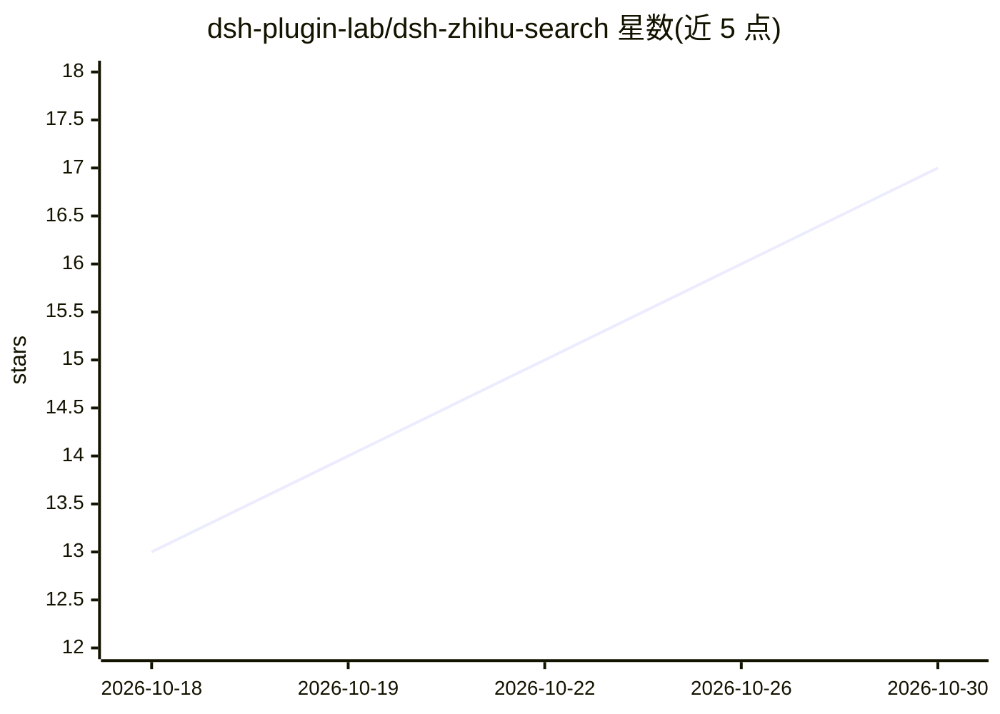

# dsh-plugin-lab/dsh-zhihu-search

⭐ 17 · TypeScript · MIT · 推送 2026-10-20 · [GitHub](https://github.com/dsh-plugin-lab/dsh-zhihu-search) · [官网](https://zl-vertex.feishu.cn/wiki/VDGtwUOzIiWNEUkXiGHcvzYDnLc) · 组织维护 · 中文 README

**给 DeepSeek Harness 装上知乎搜索能力的 DSH 插件**

面向 DeepSeek Harness（DSH）宿主的插件，基于知乎开放平台官方 API 为模型提供三个工具：zhihu_search 站内检索（支持点赞/评论/时间排序与日期过滤）、zhihu_global_search 全网索引检索（可按域名过滤）、zhihu_zhida 直答（返回知乎生成的综合回答）。搜索结果返回带 URL 的结构化来源条目。需配置知乎 Access Secret，通过 npm 或源码安装，宿主需 Node>=20 且落在 engines.dsh 声明的版本范围内；旧宿主下工具可用但配置界面不出现。

## 筛选速览

| 维度 | 判定 | 备注 |
|---|---|---|
| AI 角色 | `ai-ecosystem` | LLM/agent 周边工具 |
| 许可风险 | `permissive` | MIT |
| 部署形态 | `library` | 以包/库形式分发 |
| 模型依赖 | locked-api |  |
| 硬件要求 | — | 无带数字的原话,不猜 |
| 安装摩擦 | `low` | 无编译、无系统依赖或容器化 |
| 成熟度 | — | 结构信号不足 |

## 能力要点

- 三个工具：站内检索、全网索引检索、知乎直答
- 搜索结果附带可引用 URL 的结构化来源条目
- 基于知乎开放平台官方 API，非爬虫；密钥存凭据存储不进配置文件
- 可隐藏宿主原生 web_search/web_fetch，仅用知乎三工具

## 适用场景

- 让 DSH 内的模型检索知乎问答与文章获取中文经验
- 按域名过滤查找特定网站上的公开资料
- 通过知乎直答获取成体系的综合性回答

## 场景标签

 · 领域:LLM 工具/检索插件

## 证据(README 行号)

> L7:  赋予 DeepSeek Harness 检索知乎社区的能力
> L34: 装上后模型多出三个工具：
> L92: - **DSH 的区间见 package.json 的 `engines.dsh`** —— 那是唯一真源，它与全部 `@deepseek-ai/dsh-*` 声明**逐字相同**（不同形状时使用者装到的宿主可能缺接缝，而接缝缺席

## 星数曲线

2026-10-18 13 → 2026-10-30 17（+4）

---
*卡片 v1 · prompt 1.4 · 生成 2026-10-30 · 置信度 high · 依据 README sha `74391f623167` · [字段定义](../../DATASET.md)*
