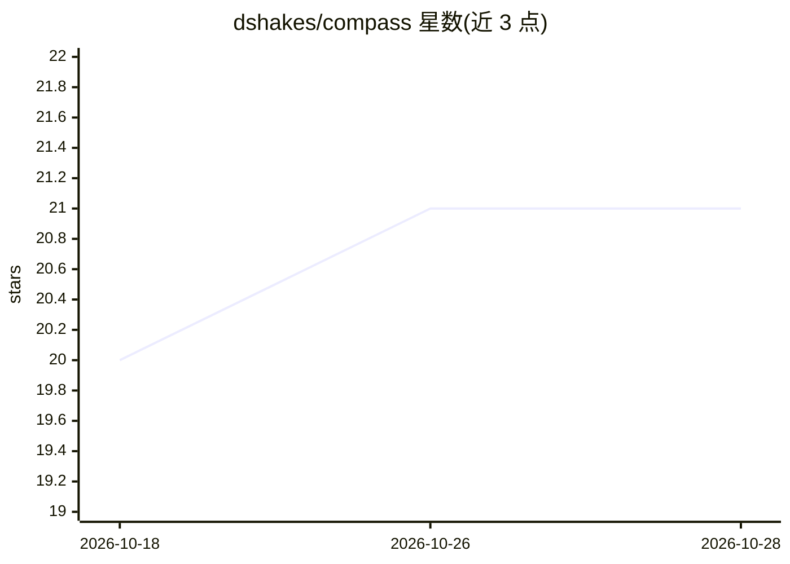

# dshakes/compass

⭐ 21 · Shell · MIT · 推送 2026-10-19 · [GitHub](https://github.com/dshakes/compass) · [官网](https://dshakes.github.io/compass/) · 个人维护

**给 AI 编程代理加护栏的本地配置层：预算硬停、命令拦截与自修复 PR 循环**

面向 Claude Code / Codex / Gemini CLI 的本地优先配置层：在代理运行前拦截危险命令与敏感文件写入，达到美元预算上限（COMPASS_MAX_USD）时在下一次工具调用前硬停会话；对 PR 执行评审、安全检查、测试与双模型交叉审计，并在轮次上限内自动推送修复直至通过，最终停在人工合并门。护栏策略在 CI 中以标注语料评测（61 例基准 + 147 例绕过语料，README 称 100% P/R）。另提供成本路由、供应链 provenance 校验与插件审计命令。通过 Homebrew、git clone 或插件市场安装，替换 ~/.claude 配置为符号链接并先做备份。仓库自标 beta。

## 筛选速览

| 维度 | 判定 | 备注 |
|---|---|---|
| AI 角色 | `ai-ecosystem` | LLM/agent 周边工具 |
| 许可风险 | `permissive` | MIT |
| 部署形态 | `None` |  |
| 模型依赖 | — | README 未给出锁定关系 |
| 硬件要求 | — | 无带数字的原话,不猜 |
| 安装摩擦 | `medium` | 含编译或系统依赖之一 |
| 成熟度 | `idea` | |

## 能力要点

- 危险命令与敏感写入在执行前拦截，护栏策略经 CI 标注语料评测
- COMPASS_MAX_USD 预算上限在下次工具调用前硬停会话
- PR 自修复循环：评审 + 双模型交叉审计 + 自动修复（轮次上限 ×3），停在人工合并门
- 无遥测、无 curl|sh，安装完全可逆并自动备份原配置

## 适用场景

- 给 Claude Code/Codex/Gemini 代理设置花费上限，防止失控烧钱
- 拦截 rm -rf / 等灾难性命令与提示注入攻击
- 让 PR 自动跑评审、安全检查与测试并自我修复到绿再由我合并
- 安装第三方插件前扫描注入与工具投毒风险

## 场景标签

`代码审查` `网络安全` · 领域:编码与开发

## 证据(README 行号)

> L25: **compass is a local-first config layer for Claude Code, Codex & Gemini that stops your agent from doing three thin
> L39: Open a PR and compass **reviews it, security-checks it, runs the tests, cross-audits it with two more models — thre
> L128: **Pick the door that fits — all reversible, version-pinnable, no `curl | sh`.** You need an AI assistant (Claude C

## 星数曲线

2026-10-18 20 → 2026-10-28 21（+1）

---
*卡片 v1 · prompt 1.4 · 生成 2026-10-28 · 置信度 high · 依据 README sha `8425cd41f5d7` · [字段定义](../../DATASET.md)*
