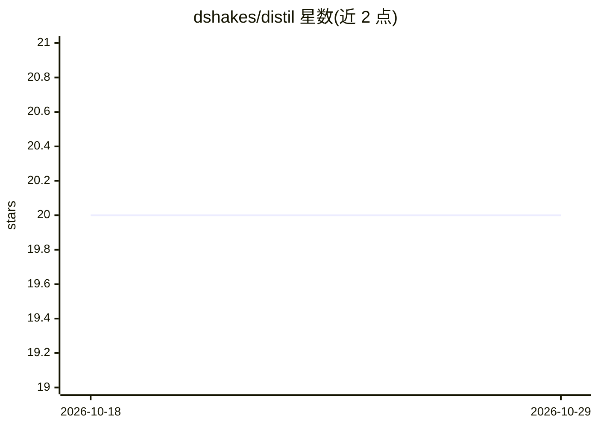

# dshakes/distil

⭐ 20 · Python · NOASSERTION · 推送 2026-10-28 · [GitHub](https://github.com/dshakes/distil) · [官网](https://dshakes.github.io/distil/) · 个人维护

**LLM 上下文压缩与成本审计工具：压缩 agent 上下文并核验各压缩器真实账单**

面向使用编码 agent 的开发者，提供缓存感知的上下文压缩与计量：以代理/网关包裹 18 种编码 agent（claude、codex、copilot 等），或以库、MCP server、框架钩子接入；压缩默认无损，摘要内容本地留存并可用 distil_expand 工具逐字节找回，且不改写仍在提示缓存中的字节。同时用 distil audit 在真实账单上评测任意压缩器（含 Anthropic context editing、OpenAI compaction、Headroom）是否改变 agent 行为及成本。限制：自身节省目前基于维护者流量估算，短任务实测成本持平，长会话试点结论未定。

## 筛选速览

| 维度 | 判定 | 备注 |
|---|---|---|
| AI 角色 | `ai-ecosystem` | LLM/agent 周边工具 |
| 许可风险 | `none` | NOASSERTION |
| 部署形态 | `self-host` | docker 或自建部署 |
| 模型依赖 | — | README 未给出锁定关系 |
| 硬件要求 | — | 无带数字的原话,不猜 |
| 安装摩擦 | `low` | 无编译、无系统依赖或容器化 |
| 成熟度 | — | 结构信号不足 |

## 能力要点

- 无损默认：压缩字节本地留存，distil_expand 可找回原文
- 不改写 provider 仍缓存的字节，保护提示缓存
- distil audit 用真实账单评测各压缩器的成本与行为影响
- 4 种接入方式：agent wrap / 代理网关 / MCP server / 库，覆盖 Anthropic、OpenAI、Azure、Gemini

## 适用场景

- 我想知道上下文压缩到底给我的编码 agent 省了还是亏了钱
- 按量计费下压缩重复工具输出以降低 token 开销
- 给自研 agent 框架接入可逆的上下文压缩库

## 场景标签

`Agent 记忆` · 领域:Agent 开发

## 证据(README 行号)

> L55: - **Run a proxy** — point any `base_url` client at it. Python, TypeScript, any language, any framework. Sync proxy,
> L56: - **Call it as a library** — `from distil import compress_messages` in your own agent loop.
> L79:  Four ways to run distil — agent wrap, proxy/gateway, MCP server, and the in-process library. Wrap, proxy and MCP r

## 星数曲线

2026-10-18 20 → 2026-10-29 20（+0）

---
*卡片 v1 · prompt 1.4 · 生成 2026-10-28 · 置信度 mid · 依据 README sha `42db5207bd83` · [字段定义](../../DATASET.md)*
