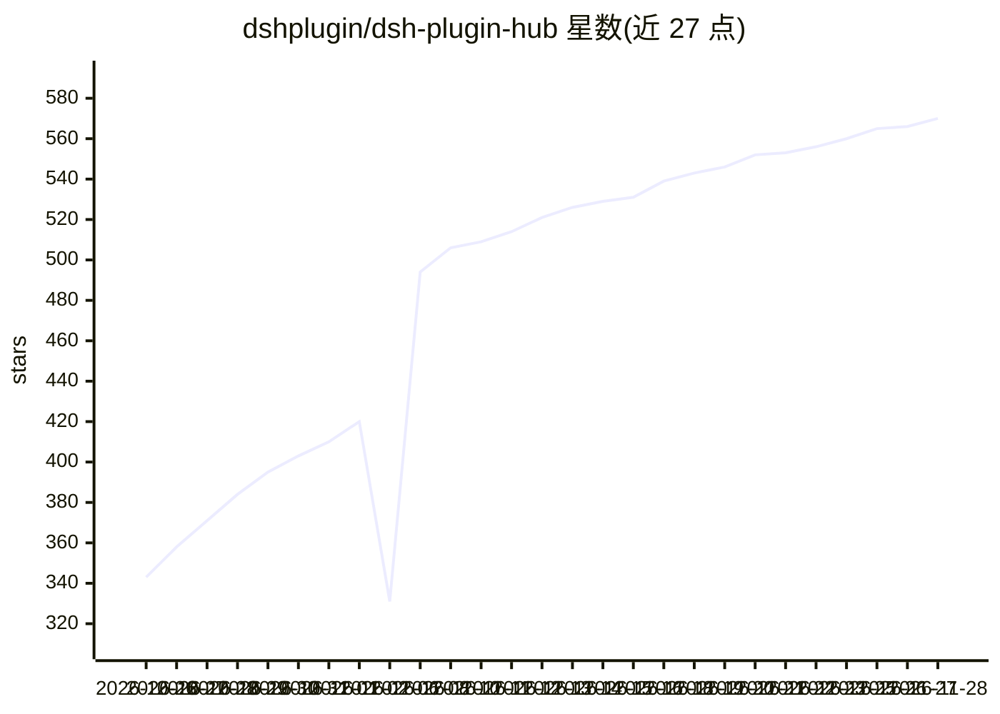

# dshplugin/dsh-plugin-hub

⭐ 570 · TypeScript · MIT · 推送 2026-11-26 · [GitHub](https://github.com/dshplugin/dsh-plugin-hub) · [官网](https://dsh-plugin.org) · 组织维护 · 中文 README

**DeepSeek Harness 社区插件市场：应用内一键浏览与安装插件**

作为 DeepSeek Harness 的开源社区插件，安装进宿主的「设置 → 插件市场」后无需离开应用即可浏览、搜索、安装、升级与卸载社区插件。目录数据与 dsh-plugin.org 官网同源，收录 27,000+ 插件、其中 7,000+ 发布为 NPM 包，条目经人工核查安装命令、兼容性与目标版本后展示。提供安装队列、通知中心、npm 镜像源切换、系统日志等宿主端能力。仅提供 npm 安装途径，不支持源码/git 安装；需 Node.js >= 22.6 与 pnpm。

## 筛选速览

| 维度 | 判定 | 备注 |
|---|---|---|
| AI 角色 | `ai-ecosystem` | LLM/agent 周边工具 |
| 许可风险 | `permissive` | MIT |
| 部署形态 | `library` | 以包/库形式分发 |
| 模型依赖 | — | README 未给出锁定关系 |
| 硬件要求 | — | 无带数字的原话,不猜 |
| 安装摩擦 | `low` | 无编译、无系统依赖或容器化 |
| 成熟度 | — | 结构信号不足 |

## 能力要点

- 收录 27,000+ 插件，7,000+ 可一键安装的 NPM 包，条目经人工核查并标注 verified
- 安装/升级/卸载全程可视化，带后台队列、确认弹窗与通知中心留痕
- 支持 npm 镜像源切换、自动换源与 HTTP 代理配置
- 中英双语界面，按 Star/Fork/更新时间排序与全文搜索

## 适用场景

- 在 DeepSeek Harness 网页版或桌面版内一站发现并安装社区插件
- 集中管理已装插件的更新、卸载与版本历史
- 网络受限环境下通过镜像源与代理完成插件安装
- 发布自己的插件并提交到目录供他人安装

## 场景标签

 · 领域:AI 工具生态/插件市场

## 证据(README 行号)

> L21: DSH Plugin Hub 是 **DeepSeek Harness 社区插件市场**：一个遵循官方插件开发规范构建的开源插件，安装进「设置 → 插件市场」后，无需离开应用即可浏览、搜索并一键安装社区插件。官方网页版（`dsh 
> L116: - **Node.js >= 22.6**：插件按该版本声明（`engines`），宿主与命令行 `dsh` 均需满足
> L41: - 主站收录 **27,000+** 个社区插件，其中 **7,000+** 个已发布 NPM 包、可在插件市场一键安装；目录由 dsh-plugin.org 每日收录，可安装条目均经人工审核

## 星数曲线

2026-10-26 343 → 2026-11-28 570（+227）

---
*卡片 v1 · prompt 1.4 · 生成 2026-11-27 · 置信度 high · 依据 README sha `26d98df012fc` · [字段定义](../../DATASET.md)*
