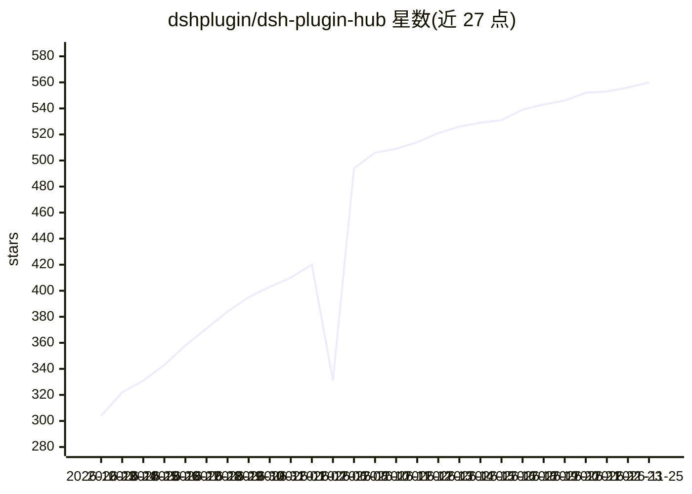

# dshplugin/dsh-plugin-hub

⭐ 560 · TypeScript · MIT · 推送 2026-11-23 · [GitHub](https://github.com/dshplugin/dsh-plugin-hub) · [官网](https://dsh-plugin.org) · 组织维护 · 中文 README

**DeepSeek Harness 的社区插件市场插件，应用内浏览与一键安装插件**

以 DSH 插件形式安装进 DeepSeek Harness（网页版 dsh web 或桌面版），在「设置 → 插件市场」内提供社区插件的浏览、搜索、一键安装/升级/卸载与任务留痕。收录数据来自 dsh-plugin.org，主站收录 27,000+ 插件，其中 7,000+ 已发布 NPM 包并可一键安装，条目经人工审核并标注分类、Star/Fork 与来源仓库。安装仅提供 npm 一条命令方式，不提供源码/git 安装；需要 Node.js ≥ 22.6、pnpm 与可用 npm 源。声明为独立社区项目，与 DeepSeek Harness 官方无隶属关系。

## 筛选速览

| 维度 | 判定 | 备注 |
|---|---|---|
| AI 角色 | `ai-ecosystem` | LLM/agent 周边工具 |
| 许可风险 | `permissive` | MIT |
| 部署形态 | `library` | 以包/库形式分发 |
| 模型依赖 | locked-api |  |
| 硬件要求 | — | 无带数字的原话,不猜 |
| 安装摩擦 | `low` | 无编译、无系统依赖或容器化 |
| 成熟度 | — | 结构信号不足 |

## 能力要点

- 应用内一键安装/升级/卸载插件，后台队列与实时进度可视化
- 收录 27,000+ 插件、7,000+ 可 NPM 一键安装，人工审核 verified 条目
- 中英双语界面与排序/全文搜索，数据与官网同源每日更新
- 本地宿主端执行安装队列与日志，声明无遥测

## 适用场景

- 在 DeepSeek Harness 里不离开应用地发现并安装社区插件
- 集中管理已装插件的更新、卸载与历史记录
- 网络不畅时换 npm 镜像源或代理完成插件安装

## 场景标签

 · 领域:AI Agent 生态/插件管理

## 证据(README 行号)

> L21: DSH Plugin Hub 是 **DeepSeek Harness 社区插件市场**：一个遵循官方插件开发规范构建的开源插件，安装进「设置 → 插件市场」后，无需离开应用即可浏览、搜索并一键安装社区插件。官方网页版（`dsh 
> L116: - **Node.js >= 22.6**：插件按该版本声明（`engines`），宿主与命令行 `dsh` 均需满足

## 星数曲线

2026-10-23 304 → 2026-11-25 560（+256）

---
*卡片 v1 · prompt 1.4 · 生成 2026-11-25 · 置信度 high · 依据 README sha `7f4aa7200df5` · [字段定义](../../DATASET.md)*
