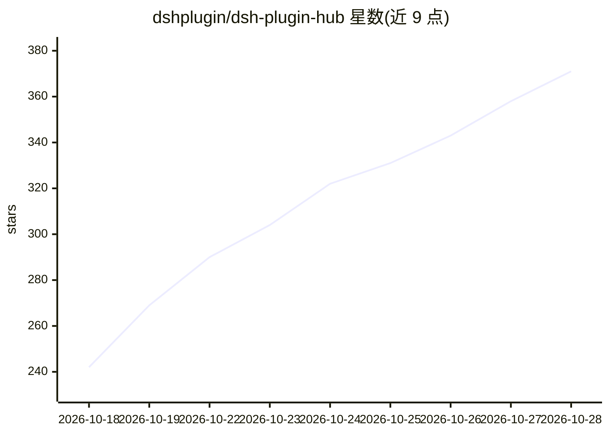

# dshplugin/dsh-plugin-hub

⭐ 384 · TypeScript · MIT · 推送 2026-10-28 · [GitHub](https://github.com/dshplugin/dsh-plugin-hub) · [官网](https://dsh-plugin.org) · 组织维护 · 中文 README

**DeepSeek Harness 的社区插件市场：浏览、搜索、一键安装插件**

以插件形式安装进 DeepSeek Harness「设置 → 插件市场」的开源社区项目，收录 4,597 个 DSH 插件（dsh-plugin.org 人工审核、每日更新），提供可视化的一键安装/升级/卸载、任务通知中心、已安装插件管理、NPM 镜像源与代理等设置及系统日志。支持中英双语界面、分类浏览与全文搜索，数据与官网同源；仅浏览器端注入，无遥测。通过 dsh 命令行从 npm 或 GitHub 安装。项目声明与 DeepSeek Harness 官方无隶属关系。

## 筛选速览

| 维度 | 判定 | 备注 |
|---|---|---|
| AI 角色 | `ai-ecosystem` | LLM/agent 周边工具 |
| 许可风险 | `permissive` | MIT |
| 部署形态 | `None` |  |
| 模型依赖 | — | README 未给出锁定关系 |
| 硬件要求 | — | 无带数字的原话,不猜 |
| 安装摩擦 | `low` | 无编译、无系统依赖或容器化 |
| 成熟度 | — | 结构信号不足 |

## 能力要点

- 收录 4,597 个人工精选验证的 DSH 插件，每日更新
- 一键安装/升级/卸载，带进度弹窗与通知中心留痕
- 自定义安装支持 NPM 包、GitHub 源码与 DSH 命令行三种通道
- 仅浏览器端注入，无宿主服务依赖，无遥测

## 适用场景

- 在 DeepSeek Harness 内直接浏览和安装社区插件
- 集中管理已装插件的更新与卸载
- 通过 GitHub topic 提交自己的插件被目录自动收录

## 场景标签

 · 领域:AI 应用生态/插件分发

## 证据(README 行号)

> L21: DSH Plugin Hub 是 **DeepSeek Harness 社区插件市场**：一个遵循官方插件开发规范构建的开源插件，安装进「设置 → 插件市场」后，无需离开应用即可浏览、搜索并一键安装社区插件。本项目为独立社区项目，
> L41: - 收录 **4,597** 个社区插件，全部已人工精选验证，由 dsh-plugin.org 每日收录、人工审核并发布
> L124: dsh plugin --profile web add dsh-plugin

## 星数曲线

2026-10-18 242 → 2026-10-28 371（+129）

---
*卡片 v1 · prompt 1.4 · 生成 2026-10-22 · 置信度 high · 依据 README sha `621bf730410f` · [字段定义](../../DATASET.md)*
