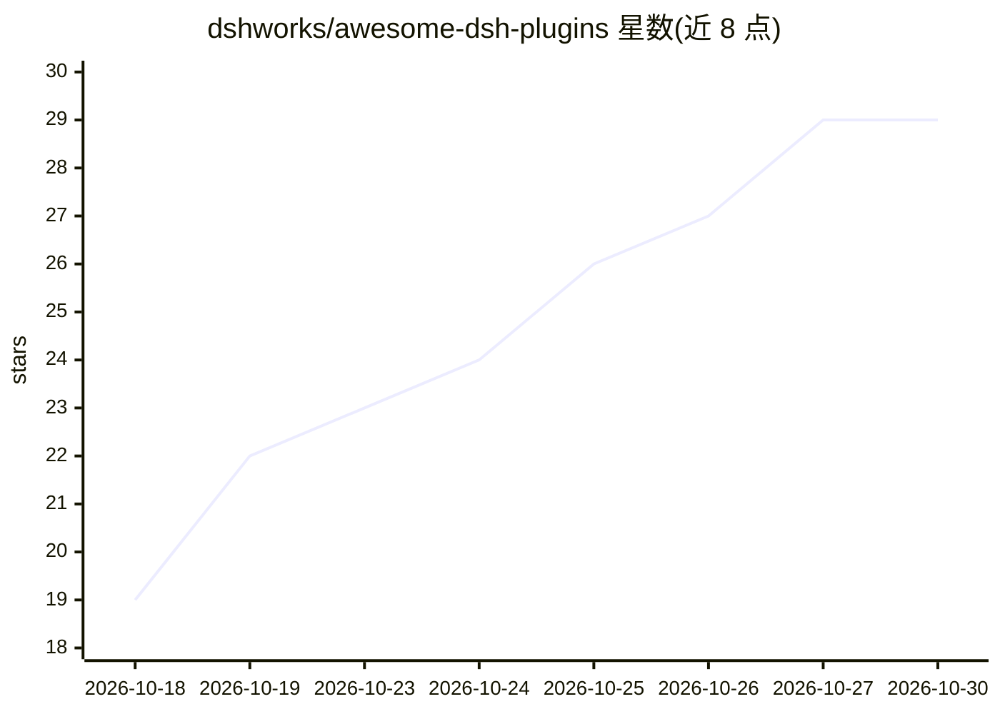

# dshworks/awesome-dsh-plugins

⭐ 29 · JavaScript · MIT · 推送 2026-10-29 · [GitHub](https://github.com/dshworks/awesome-dsh-plugins) · [官网](https://dsh.works/awesome-dsh-plugins/) · 组织维护

**DeepSeek Harness 插件开放数据注册表（20,769 条）**

面向 DeepSeek Harness（dsh）生态的机器可读插件/捆绑包/技能注册表：从 GitHub 主题与手工种子两条渠道收录 20,769 条、覆盖 17 个功能领域，每条记录安装路径证据（evidence 字段）与验证过的 dsh 版本。对 26,590 个带主题仓库人工甄别，剔除 3,172 个（拒收原因公开于 rejected.json）；npm 名称经发布包与仓库双向核对。数据源为 data/plugins.json，可经 curl 直接消费，并发布可供 dsh 0.2.1+ Discover 标签页订阅的市场索引。dsh 本身处于 developer preview，兼容性可能随版本断裂，故 schema 记录版本与日期。

## 筛选速览

| 维度 | 判定 | 备注 |
|---|---|---|
| AI 角色 | `ai-knowledge` | 知识聚合/清单类 |
| 许可风险 | `permissive` | MIT |
| 部署形态 | `None` |  |
| 模型依赖 | locked-api |  |
| 硬件要求 | — | 无带数字的原话,不猜 |
| 安装摩擦 | `medium` | 含编译或系统依赖之一 |
| 成熟度 | — | 结构信号不足 |

## 能力要点

- 20,769 条条目、12,181 位作者、17 个功能领域，数据以 plugins.json 为唯一事实源
- 每条携带安装路径证据（path#key）与 verifiedAgainst/lastVerified 版本与日期
- 拒收条目连同原因与复查日期公开在 rejected.json
- 发布市场索引 JSON，供 dsh 0.2.1+ 的 Discover 标签页直接订阅

## 适用场景

- 为 dsh 查找并按星标/功能领域筛选插件与技能
- 在自己的工具中直接构建于 plugins.json 数据之上
- 核对某个插件的安装证据与 dsh 版本兼容性

## 场景标签

`精选清单` · 领域:学习与行业

## 证据(README 行号)

> L7: A spam-filtered, open-data registry of DeepSeek Harness (`dsh`) plugins, bundles, and skills — 20,769 entries from 1
> L11: Most awesome lists are prose. This one is data: `data/plugins.json` is the source of truth, this README is rendered

## 星数曲线

2026-10-18 19 → 2026-10-30 29（+10）

---
*卡片 v1 · prompt 1.4 · 生成 2026-10-26 · 置信度 high · 依据 README sha `77345812d2a7` · [字段定义](../../DATASET.md)*
