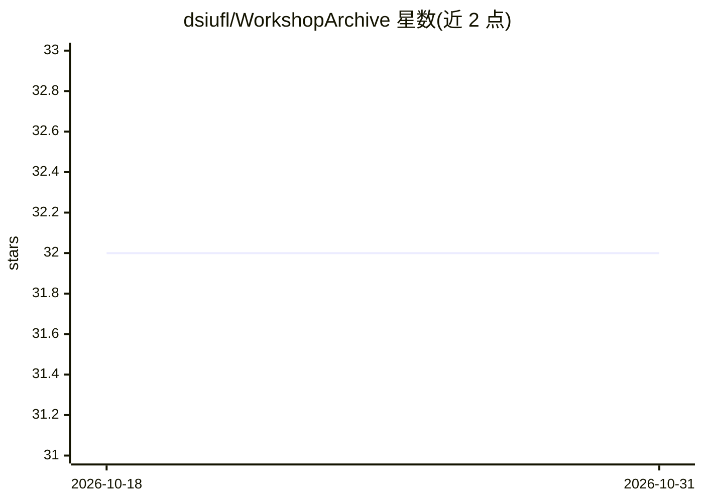

# dsiufl/WorkshopArchive

⭐ 32 · Jupyter Notebook · 推送 2026-10-03 · [GitHub](https://github.com/dsiufl/WorkshopArchive) · 组织维护

**佛罗里达大学 2023-2026 数据科学/AI/ML 教学工作坊存档**

佛罗里达大学学生组织维护的教学工作坊内容仓库，按主题组织为约 20 个工作坊条目，覆盖 C 语言入门、GPU 加速科学计算、CNN、PyTorch、语言模型、Sentence Transformers、AI Agents、NLP、Pandas、SQL 等，每条含简介与贡献者名单。README 仅提供工作坊清单与贡献流程（Fork/PR），不含安装运行说明。内容为线下面向参与者的教学材料。

## 筛选速览

| 维度 | 判定 | 备注 |
|---|---|---|
| AI 角色 | `ai-knowledge` | 知识聚合/清单类 |
| 许可风险 | `none` | — |
| 部署形态 | `None` |  |
| 模型依赖 | — | README 未给出锁定关系 |
| 硬件要求 | — | 无带数字的原话,不猜 |
| 安装摩擦 | `low` | 无编译、无系统依赖或容器化 |
| 成熟度 | — | 结构信号不足 |

## 能力要点

- 约 20 个主题条目，覆盖 AI/ML 与数据科学工具链
- 每条含简介与贡献者署名
- 提供社区贡献流程（Fork/分支/PR）

## 适用场景

- 查找 AI/ML/数据科学入门教学材料
- 了解工作坊主题覆盖与贡献者
- 按流程为仓库贡献新工作坊内容

## 场景标签

`教程课程` · 领域:学习与行业

## 证据(README 行号)

> L11: |AI Chronicles|Exploring the past, present, and future of AI.|Matt, Jim, Matheus|
> L19: |PyTorch|Deep learning with PyTorch.|Jim, Matheus|
> L26: |Intro to AI Agents|Building an AI Agent in Python.|Ragul|

## 星数曲线

2026-10-18 32 → 2026-10-31 32（+0）

---
*卡片 v1 · prompt 1.4 · 生成 2026-10-26 · 置信度 high · 依据 README sha `e6321844126c` · [字段定义](../../DATASET.md)*
