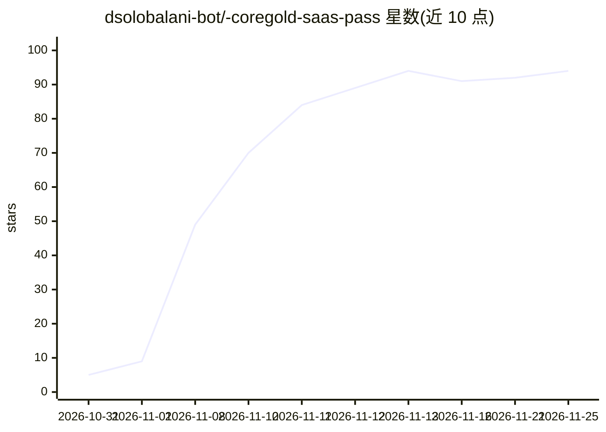

# dsolobalani-bot/-coregold-saas-pass

⭐ 94 · 推送 2026-10-30 · [GitHub](https://github.com/dsolobalani-bot/-coregold-saas-pass) · [官网](https://app.coregold.io/signup?invite_code=ADvlj9b) · 组织维护 · 中文 README

**推广 CoreGold 虚拟卡的 SaaS 试用防扣费指南页**

仓库内容为面向消费者的宣传性 README：介绍用 CoreGold 虚拟 Visa/Mastercard 应对海外 SaaS 平台"先绑卡试用"的流程，包括以 USDT 入金生成 USD 余额、开限额 $1-2 的单卡完成验资、试用后注销卡片阻断自动续费扣款，并对比实体信用卡在到期扣款、取消订阅、账号复用、验资通过等方面的差异。文中列举 Figma、Canva、Notion AI、Midjourney 等工具作为使用场景。仓库不含代码或可安装软件。

## 筛选速览

| 维度 | 判定 | 备注 |
|---|---|---|
| AI 角色 | `ai-knowledge` | 知识聚合/清单类 |
| 许可风险 | `none` | — |
| 部署形态 | `None` |  |
| 模型依赖 | — | README 未给出锁定关系 |
| 硬件要求 | — | 无带数字的原话,不猜 |
| 安装摩擦 | `low` | 无编译、无系统依赖或容器化 |
| 成熟度 | — | 结构信号不足 |

## 能力要点

- 介绍限额 $1-2 虚拟卡完成平台验资并阻断到期扣款的流程
- USDT 入金自动转为 USD 余额作为开卡底池
- 对比实体卡与虚拟卡在扣费、取消、复用、验资四类场景的差异

## 适用场景

- 注册海外 SaaS 试用时避免绑定真实信用卡
- 防止试用到期后自动续订扣款
- 试用结束后通过注销卡片切断扣款通道

## 场景标签

 · 领域:支付/消费工具

## 证据(README 行号)

> L9: 👉 **立即进入 CoreGold 官方开卡后台**
> L38: 👉 **点击注册并进入 CoreGold 发卡后台**

## 星数曲线

2026-10-31 5 → 2026-11-25 94（+89）

---
*卡片 v1 · prompt 1.4 · 生成 2026-11-17 · 置信度 low · 依据 README sha `f74c5e9cda30` · [字段定义](../../DATASET.md)*
