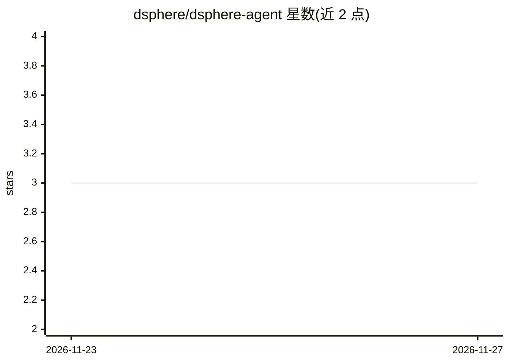

# dsphere/dsphere-agent

⭐ 3 · JavaScript · MIT · 推送 2026-11-23 · [GitHub](https://github.com/dsphere/dsphere-agent) · [官网](http://www.dsphereai.com) · 组织维护 · 中文 README

**让 AI agent 通过 MCP 操作 DSphere 浏览器的本地连接器**

DSphere Agent 是官方 Skill 与本地 stdio MCP 服务器（`dsphere-agent`），连接 AI agent 与 DSphere 浏览器扩展。agent 通过三个 MCP 工具（list_instances/list_capabilities/invoke）读取页面、点击输入、运行数据采集向导与已保存工作流；浏览器在用户已登录的会话中执行步骤，敏感操作需用户确认，支持任务面板实时观察与随时停止。支持 Windows x64/x86 与 macOS Intel/Apple Silicon，通过不可变 git tag 安装，Gitee 提供国内镜像。需先安装 DSphere 浏览器。

## 筛选速览

| 维度 | 判定 | 备注 |
|---|---|---|
| AI 角色 | `ai-ecosystem` | LLM/agent 周边工具 |
| 许可风险 | `permissive` | MIT |
| 部署形态 | `None` |  |
| 模型依赖 | — | README 未给出锁定关系 |
| 硬件要求 | — | 无带数字的原话,不猜 |
| 安装摩擦 | `low` | 无编译、无系统依赖或容器化 |
| 成熟度 | — | 结构信号不足 |

## 能力要点

- 三个稳定 MCP 工具让 agent 动态发现并调用浏览器方法
- 复用已登录会话执行任务，无需向 agent 提供密码
- 数据采集向导识别列表、表格与分页，导出 Excel/CSV
- 敏感操作等待确认，agent 只能调用浏览器发布的方法

## 适用场景

- 让 Claude Code/Cursor 等 agent 在已登录会话中执行网页操作
- 采集列表/表格网页数据并存为本地表格
- 并行运行并实时监控多个浏览器自动化任务

## 场景标签

`浏览器自动化` · 领域:效率与自动化

## 证据(README 行号)

> L24: DSphere Agent is the official Skill and local MCP connector that lets an AI agent work in the **DSphere browser**, 
> L30: The Skill installs and configures **Native Agent**, a local stdio MCP server named `dsphere-agent`, and bundles it 
> L57: 2. **Native Agent** is a local stdio MCP server, installed and configured through the Skill. It passes each step to

## 星数曲线

2026-11-23 3 → 2026-11-27 3（+0）

---
*卡片 v1 · prompt 1.4 · 生成 2026-11-23 · 置信度 high · 依据 README sha `22bc037898c3` · [字段定义](../../DATASET.md)*
