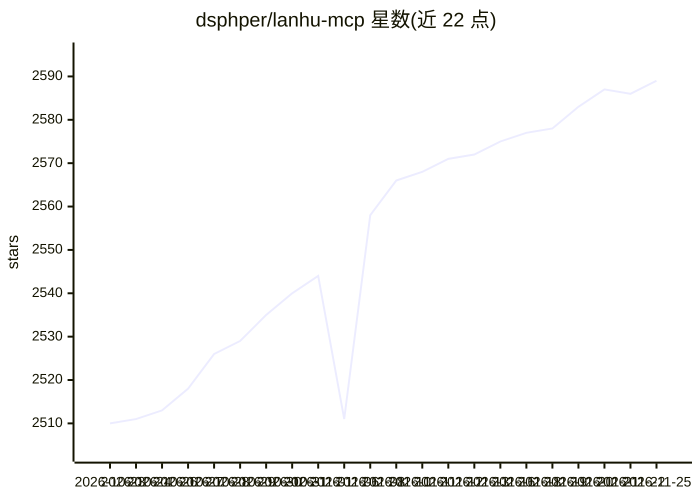

# dsphper/lanhu-mcp

⭐ 2,589 · Python · MIT · 推送 2026-11-17 · [GitHub](https://github.com/dsphper/lanhu-mcp) · 个人维护 · 中文 README

**让 AI 编程工具读取蓝湖需求与设计稿的 MCP 服务器**

面向蓝湖设计交付流程的 Model Context Protocol 服务器：下载并解析 Axure 需求页、截图与注释，提供开发/测试/探索三种分析视角与四阶段工作流；读取 UI 设计稿并返回尺寸/间距/颜色等参数与 HTML+CSS 参考，下载切图并语义化命名；内置团队留言板（normal/task/question/urgent/knowledge 五类），支持飞书 @提醒与按 Cookie 的多账号请求头隔离。支持 HTTP 与 stdio 两种启动方式，Docker 或 Python 3.10+ 源码部署，需配置蓝湖 Cookie。

## 筛选速览

| 维度 | 判定 | 备注 |
|---|---|---|
| AI 角色 | `ai-ecosystem` | LLM/agent 周边工具 |
| 许可风险 | `permissive` | MIT |
| 部署形态 | `desktop` | 安装包/桌面程序 |
| 模型依赖 | — | README 未给出锁定关系 |
| 硬件要求 | — | 无带数字的原话,不猜 |
| 安装摩擦 | `low` | 无编译、无系统依赖或容器化 |
| 成熟度 | — | 结构信号不足 |

## 能力要点

- 16 个 MCP 工具：需求页分析、设计稿局部读取、切图导出、留言板增删查改
- 团队知识库：所有接入的 AI 助手共享留言板与上下文，knowledge 类型永久保存
- HTTP 按请求隔离蓝湖 Cookie，多人共用同一服务
- 基于版本号的缓存与增量更新，长页返回带重叠区域的分块截图

## 适用场景

- 让 Cursor/Claude Code 等 AI IDE 直接读取蓝湖需求文档和设计稿
- 开发 AI 分析的需求结果供测试 AI 直接查询复用
- 批量下载设计切图并按项目类型输出到工程目录
- 团队踩坑经验沉淀为可搜索的知识库留言

## 场景标签

`编码 Agent` · 领域:编码与开发

## 证据(README 行号)

> L23: 一个面向蓝湖设计交付与需求阅读的 Model Context Protocol (MCP) 服务器。由 MCP 提供来源数据和资源，大模型结合画面理解并适配目标工程。
> L38: - ✅ Cursor + 蓝湖：让 Cursor AI 直接读取蓝湖需求文档和设计稿
> L418: |工具名称|功能描述|使用场景|

## 星数曲线

2026-10-23 2,510 → 2026-11-25 2,589（+79）

---
*卡片 v1 · prompt 1.4 · 生成 2026-11-23 · 置信度 high · 依据 README sha `ee706b61b1e5` · [字段定义](../../DATASET.md)*
