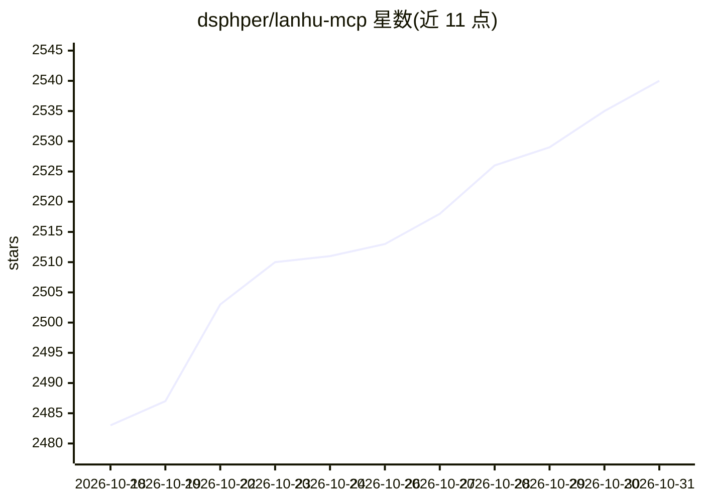

# dsphper/lanhu-mcp

⭐ 2,540 · Python · MIT · 推送 2026-10-27 · [GitHub](https://github.com/dsphper/lanhu-mcp) · 个人维护 · 中文 README

**面向蓝湖设计交付的 MCP 服务器：让 AI 客户端读取需求文档与设计稿并共享团队知识**

基于 FastMCP 的 Model Context Protocol 服务器，用 Python 3.10+ 编写，面向使用蓝湖做设计交付的研发团队。提供约 17 个 MCP 工具：解析 Axure 原型页面与注释（开发/测试/探索三种视角、四阶段工作流）、读取 UI 设计稿并返回尺寸/颜色/字体参数与 HTML+CSS 参考、下载切图与原始素材，以及团队留言板（normal/task/question/urgent/knowledge 五种消息类型）让多个开发者的 AI 助手共享知识与上下文，支持飞书 @提醒。需配置蓝湖 Cookie，要求客户端使用具备视觉能力的模型，不支持纯文本模型。提供 Docker、源码、wheel 等安装方式。

## 筛选速览

| 维度 | 判定 | 备注 |
|---|---|---|
| AI 角色 | `ai-ecosystem` | LLM/agent 周边工具 |
| 许可风险 | `permissive` | MIT |
| 部署形态 | `desktop` | 安装包/桌面程序 |
| 模型依赖 | — | README 未给出锁定关系 |
| 硬件要求 | — | 无带数字的原话,不猜 |
| 安装摩擦 | `low` | 无编译、无系统依赖或容器化 |
| 成熟度 | — | 结构信号不足 |

## 能力要点

- 解析 Axure 需求页面与注释，提供开发/测试/快速探索三种分析模式
- 读取设计稿返回样式参数与 HTML+CSS 参考代码，下载并校验切图素材
- 团队留言板让多个 AI 客户端共享知识库，含只读安全限制的 task 类型
- 基于版本号的永久缓存、增量更新与并发下载

## 适用场景

- 在 Cursor/Claude Code 等 AI IDE 中直接读取蓝湖需求文档和设计稿
- 团队多角色共享需求分析与踩坑经验，避免各 AI 重复分析
- 自动下载设计切图并按语义化命名放入前端工程

## 场景标签

`文档解析` · 领域:知识与检索

## 证据(README 行号)

> L23: 一个面向蓝湖设计交付与需求阅读的 Model Context Protocol (MCP) 服务器。由 MCP 提供来源数据和资源，大模型结合画面理解并适配目标工程。
> L9: MCP
> L36: - ✅ Cursor + 蓝湖：让 Cursor AI 直接读取蓝湖需求文档和设计稿

## 星数曲线

2026-10-18 2,483 → 2026-10-31 2,540（+57）

---
*卡片 v1 · prompt 1.4 · 生成 2026-10-21 · 置信度 high · 依据 README sha `0390843f821d` · [字段定义](../../DATASET.md)*
