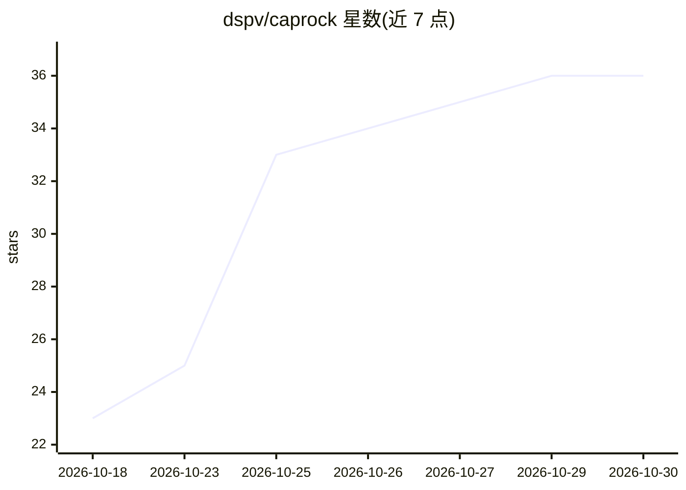

# dspv/caprock

⭐ 36 · Go · Apache-2.0 · 推送 2026-10-29 · [GitHub](https://github.com/dspv/caprock) · [官网](https://caprock.dev) · 个人维护

**本地桌面应用：并排运行多个编码 agent 并追踪成本**

macOS/Windows/Linux 桌面应用，底层为本地 daemon 并内嵌浏览器 dashboard。可在终端标签页中并排运行 Claude Code、Codex、OpenCode、Gemini CLI 与 Hermes Agent 会话，按项目与 git worktree 组织；Pipeline 视图展示 PR 到发布的检查、耗时与 agent 花费，支持从通知、菜单栏或手机远程批准权限提示；按 API 牌价估算每个仓库成本并显示套餐限额，历史记录存于本地 SQLite。无账户、无遥测，Apache-2.0 开源。

## 筛选速览

| 维度 | 判定 | 备注 |
|---|---|---|
| AI 角色 | `ai-ecosystem` | LLM/agent 周边工具 |
| 许可风险 | `permissive` | Apache-2.0 |
| 部署形态 | `desktop` | 安装包/桌面程序 |
| 模型依赖 | locked-api |  |
| 硬件要求 | — | 无带数字的原话,不猜 |
| 安装摩擦 | `low` | 无编译、无系统依赖或容器化 |
| 成熟度 | — | 结构信号不足 |

## 能力要点

- 多编码 agent（Claude Code/Codex/OpenCode/Gemini CLI 等）并排运行与会话管理
- 按 API 牌价估算每仓库/每服务成本，显示套餐限额与预警
- 权限提示可从通知、菜单栏或配对手机远程批准
- 本地 SQLite 存储、caprock mcp 只读接口与 caprock report 报告输出

## 适用场景

- 同时运行多个编码 agent 并在一个窗口管理会话
- 追踪各仓库的 agent token 成本与订阅限额
- 从 PR 到发布跟进 CI 检查并让 agent 修复冲突
- 保留并搜索超出 Claude Code 30 天清理期限的会话历史

## 场景标签

`编码 Agent` `LLM 可观测性` · 领域:编码与开发

## 证据(README 行号)

> L70: Claude Code, Codex, OpenCode and Gemini CLI in tabs and split panes, per
> L115: Caprock is a desktop app; under it runs a local daemon that also serves a

## 星数曲线

2026-10-18 23 → 2026-10-30 36（+13）

---
*卡片 v1 · prompt 1.4 · 生成 2026-10-26 · 置信度 mid · 依据 README sha `f9f1f9161458` · [字段定义](../../DATASET.md)*
