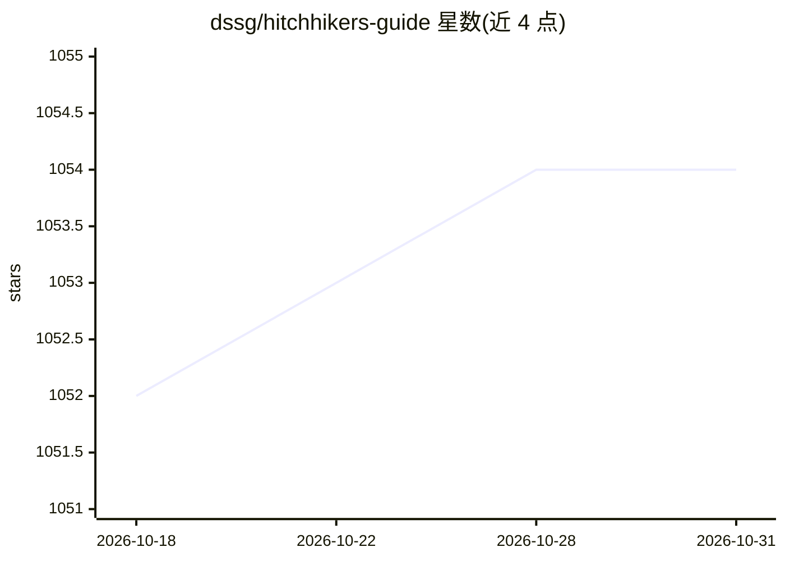

# dssg/hitchhikers-guide

⭐ 1,054 · Jupyter Notebook · 推送 2026-07-16 · [GitHub](https://github.com/dssg/hitchhikers-guide) · [官网](https://dssg.github.io/hitchhikers-guide/) · 组织维护

**面向社会公益的数据科学训练营课程与教程合集**

DSSG（Data Science for Social Good）项目的培训资料库：介绍该项目背景，并汇总面向研究员的培训手册、暑期课程大纲、教程与维基。内容覆盖数据获取与 ETL、数据探索、建模与机器学习、因果推断、编程最佳实践、伦理与隐私等主题，教程形式包括 SQL、Python、Git/GitHub、GIS 等。主要读者是 DSSG 研究员，也向公众开放自学与贡献。全部材料以 CC BY 4.0 许可发布。

## 筛选速览

| 维度 | 判定 | 备注 |
|---|---|---|
| AI 角色 | `ai-knowledge` | 知识聚合/清单类 |
| 许可风险 | `none` | — |
| 部署形态 | `None` |  |
| 模型依赖 | — | README 未给出锁定关系 |
| 硬件要求 | — | 无带数字的原话,不猜 |
| 安装摩擦 | `low` | 无编译、无系统依赖或容器化 |
| 成熟度 | — | 结构信号不足 |

## 能力要点

- 覆盖数据管道、数据探索、机器学习、因果推断等 8 个课程模块
- 包含反骚扰政策、项目流程等训练营运营手册
- 维基收录命令行、数据库、EC2/RStudio 等环境操作指引
- 全部材料以 CC BY 4.0 许可开放

## 适用场景

- 准备参加 DSSG 项目的研究员提前了解项目与培训内容
- 自学者系统学习面向社会公益的数据科学课程
- 其他机构借鉴课程结构启动类似 DSSG 项目

## 场景标签

`教程课程` · 领域:学习与行业

## 证据(README 行号)

> L23: Our number one priority at DSSG is to **train fellows to do responsible data science/ML/AI for social good work**. 
> L54: ## Curriculum

## 星数曲线

2026-10-18 1,052 → 2026-10-31 1,054（+2）

---
*卡片 v1 · prompt 1.4 · 生成 2026-10-21 · 置信度 high · 依据 README sha `5c82fecfa658` · [字段定义](../../DATASET.md)*
