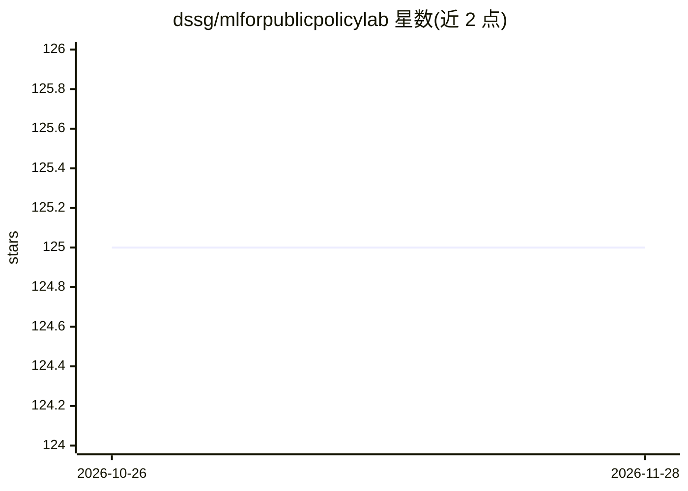

# dssg/mlforpublicpolicylab

⭐ 125 · Jupyter Notebook · MIT · 推送 2026-11-24 · [GitHub](https://github.com/dssg/mlforpublicpolicylab) · [官网](https://dssg.github.io/mlforpublicpolicylab/) · 组织维护

**CMU 公共政策机器学习实践课程的材料仓库**

卡内基梅隆大学 Heinz 学院研究生课程 94889 的仓库，存放课程表、教学大纲、项目要求与评分政策等材料。课程以项目制方式训练学生用机器学习解决公共政策与社会公益领域的实际问题，覆盖问题定义、数据清洗、建模、模型可解释性、算法偏见识别与缓解、部署后影响评估等环节。课程使用共享 PostgreSQL 数据库，建模采用 triage 机器学习流水线包，作业经 Canvas 提交。先修要求包括 Python、SQL 与研究生机器学习课程。材料以 MIT 许可发布。

## 筛选速览

| 维度 | 判定 | 备注 |
|---|---|---|
| AI 角色 | `ai-knowledge` | 知识聚合/清单类 |
| 许可风险 | `permissive` | MIT |
| 部署形态 | `None` |  |
| 模型依赖 | — | README 未给出锁定关系 |
| 硬件要求 | — | 无带数字的原话,不猜 |
| 安装摩擦 | `low` | 无编译、无系统依赖或容器化 |
| 成熟度 | — | 结构信号不足 |

## 能力要点

- 项目制课程：端到端构建公共政策领域的机器学习系统
- 内容涵盖模型可解释性、算法偏见与伦理议题
- 课程基础设施基于 PostgreSQL 与 triage 建模流水线包
- 课程材料以 MIT 许可发布

## 适用场景

- 旁听或自学公共政策方向的机器学习课程材料
- 教师参考该课程结构设计类似的实践型教学
- 了解机器学习在公共服务项目中的落地流程

## 场景标签

`教程课程` · 领域:学习与行业

## 证据(README 行号)

> L24: This is a project-based course designed to provide training and experience in solving real-world problems using mac
> L42: Project work uses a shared data and ML infrastructure provided for the class. Data lives in a PostgreSQL database; 

## 星数曲线

2026-10-26 125 → 2026-11-28 125（+0）

---
*卡片 v1 · prompt 1.4 · 生成 2026-11-28 · 置信度 high · 依据 README sha `047537143923` · [字段定义](../../DATASET.md)*
