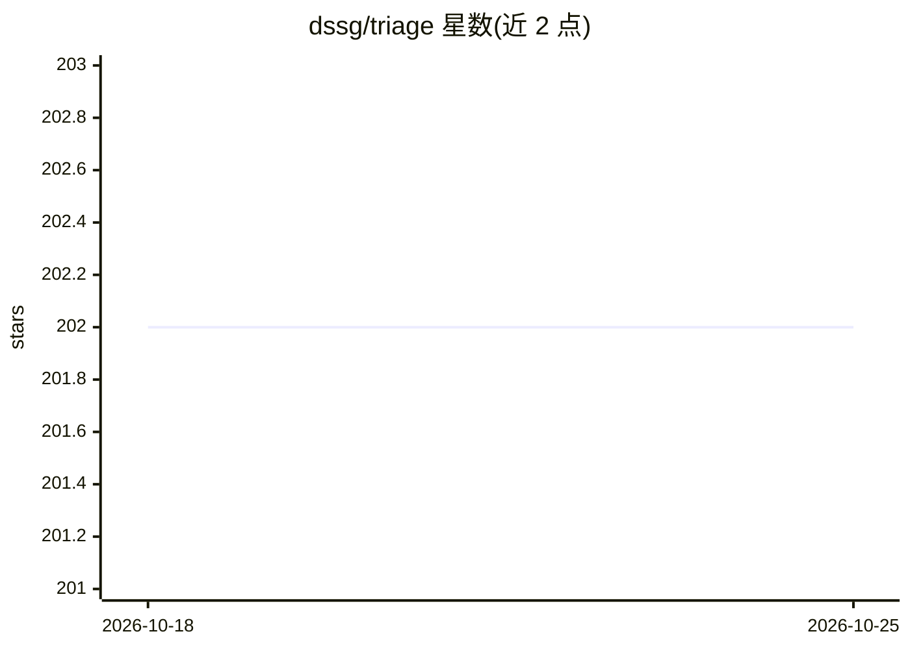

# dssg/triage

⭐ 202 · Jupyter Notebook · NOASSERTION · 推送 2026-09-24 · [GitHub](https://github.com/dssg/triage) · 组织维护

**面向公共政策的通用风险建模与预测工具包**

由芝加哥大学/卡内基梅隆大学团队维护的 Python 机器学习工具包，服务于公共政策与社会公益场景的数据科学家、分析师与研究者。它将队列选择、特征生成、模型训练、评估、偏差审计、解释与清单生成等实验环节整合为统一工作流，通过 config.yaml 配置驱动，以 CLI（triage experiment）或 Python 包形式运行。要求 Ubuntu/RedHat、Python 3.10+、PostgreSQL 13+ 数据库存放源数据，磁盘需有存储实验矩阵与模型的空间。

## 筛选速览

| 维度 | 判定 | 备注 |
|---|---|---|
| AI 角色 | `ai-native` | 本体是模型或模型工具 |
| 许可风险 | `none` | NOASSERTION |
| 部署形态 | `library` | 以包/库形式分发 |
| 模型依赖 | — | README 未给出锁定关系 |
| 硬件要求 | — | 无带数字的原话,不猜 |
| 安装摩擦 | `low` | 无编译、无系统依赖或容器化 |
| 成熟度 | — | 结构信号不足 |

## 能力要点

- 以配置文件驱动的端到端 ML 实验流水线（特征-训练-评估-审计-清单生成）
- 提供偏差审计与模型解释环节
- 支持 CLI 与 Python 包两种使用方式
- 可用 triage db up 通过 Docker 创建 Postgres 数据库

## 适用场景

- 为公共政策问题（如巡查优先级排序）搭建预测建模流水线
- 在统一工作流中完成特征生成、模型训练与评估选型
- 对自己的 ML 实验执行偏差审计

## 场景标签

`MLOps` · 领域:训练与推理

## 证据(README 行号)

> L1: Triage
> L9: Building ML/Data Science systems requires answering many design questions, turning them into modeling choices, which
> L87: Triage was initially developed at University of Chicago's Center For Data Science and Public Policy and is now bein

## 星数曲线

2026-10-18 202 → 2026-10-25 202（+0）

---
*卡片 v1 · prompt 1.4 · 生成 2026-10-22 · 置信度 high · 依据 README sha `fa5febcc7d7c` · [字段定义](../../DATASET.md)*
