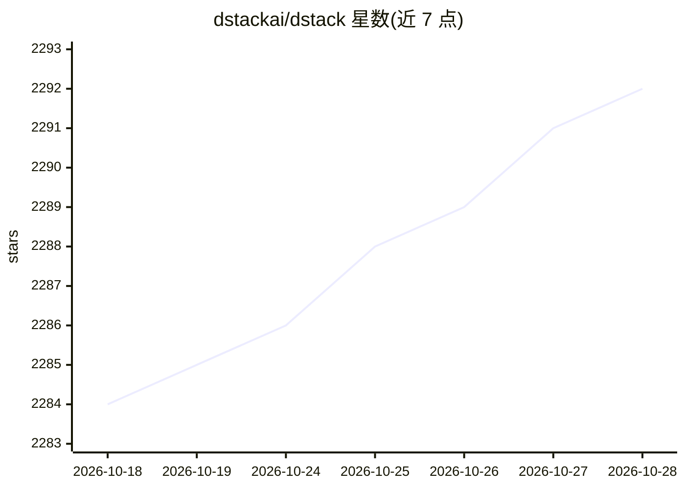

# dstackai/dstack

⭐ 2,293 · Python · MPL-2.0 · 推送 2026-10-28 · [GitHub](https://github.com/dstackai/dstack) · [官网](https://dstack.ai/docs) · 组织维护

**面向异构 AI 算力的统一编排控制平面：管理 GPU 并运行训练与推理**

dstack 是一个 GPU 供给与编排的统一控制平面，支持任意 GPU 云、Kubernetes 集群与本地集群。用户先部署 dstack server（Linux/macOS/Windows WSL2，需 Git 与 OpenSSH），通过 CLI 或 API 定义 Fleets、Dev 环境、Tasks、Services、Volumes 等配置，以 YAML 声明后经 dstack apply 提交，系统自动处理供给、排队、自动扩缩容、网络与卷管理等。支持 NVIDIA、AMD、Google TPU、Tenstorrent 加速器；另提供 agent skills 供 Claude/Codex/Cursor 等 AI 代理代为操作。MPL 2.0 许可，由 dstack.ai 团队维护。

## 筛选速览

| 维度 | 判定 | 备注 |
|---|---|---|
| AI 角色 | `ai-ecosystem` | LLM/agent 周边工具 |
| 许可风险 | `permissive` | MPL-2.0 |
| 部署形态 | `library` | 以包/库形式分发 |
| 模型依赖 | — | README 未给出锁定关系 |
| 硬件要求 | — | 无带数字的原话,不猜 |
| 安装摩擦 | `low` | 无编译、无系统依赖或容器化 |
| 成熟度 | `idea` | |

## 能力要点

- 统一控制平面管理 GPU 云、Kubernetes 与本地集群
- 自动处理供给、排队、自动扩缩容、网络、卷与故障
- 支持 NVIDIA/AMD/Google TPU/Tenstorrent 加速器
- 提供 agent skills 供 AI 代理创建和管理资源

## 适用场景

- 跨云与本地集群统一供给 GPU 并编排训练/推理工作负载
- 将模型推理部署为安全可扩展的端点
- 通过 AI 代理（Claude/Codex/Cursor）代为管理集群与提交任务

## 场景标签

`模型训练` `推理引擎` `MLOps` · 领域:训练与推理

## 证据(README 行号)

> L11: `dstack` is a unified control plane for GPU provisioning and orchestration that works with any GPU cloud, Kubernete
> L93: * Services &mdash; Deploy model inference as secure and scalable endpoints

## 星数曲线

2026-10-18 2,284 → 2026-10-28 2,292（+8）

---
*卡片 v1 · prompt 1.4 · 生成 2026-10-21 · 置信度 high · 依据 README sha `e88367af2865` · [字段定义](../../DATASET.md)*
