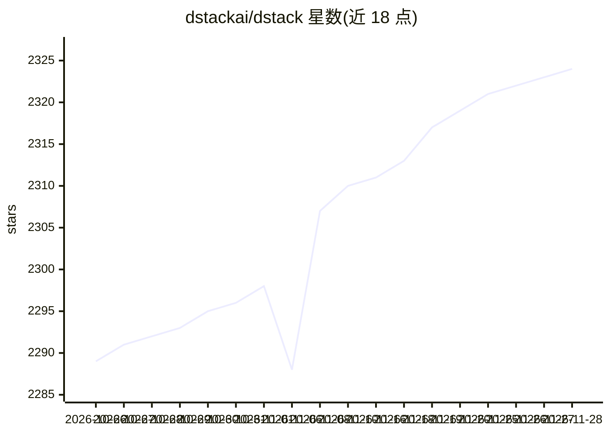

# dstackai/dstack

⭐ 2,324 · Python · MPL-2.0 · 推送 2026-11-27 · [GitHub](https://github.com/dstackai/dstack) · [官网](https://dstack.ai/docs) · 组织维护

**为团队统一编排 GPU 云、K8s 与本地集群的训练推理算力**

dstack 提供一个 GPU 供给与编排的控制平面，通过 server + CLI + YAML 配置管理跨 GPU 云、Kubernetes、VM 与本地集群的计算资源，支持 fleets、开发环境、任务、推理服务、卷等配置类型，自动处理供给、排队、自动伸缩与端口转发；开箱支持 NVIDIA、AMD、TPU、Tenstorrent 加速器，并提供 agent skills 让 Claude/Codex/Cursor 等 AI 代理代为管理集群与提交任务。服务器需 Git 与 OpenSSH，支持 Linux/macOS/Windows（WSL 2）。

## 筛选速览

| 维度 | 判定 | 备注 |
|---|---|---|
| AI 角色 | `ai-ecosystem` | LLM/agent 周边工具 |
| 许可风险 | `permissive` | MPL-2.0 |
| 部署形态 | `library` | 以包/库形式分发 |
| 模型依赖 | — | README 未给出锁定关系 |
| 硬件要求 | — | 无带数字的原话,不猜 |
| 安装摩擦 | `low` | 无编译、无系统依赖或容器化 |
| 成熟度 | — | 结构信号不足 |

## 能力要点

- 统一控制平面：跨 GPU 云、Kubernetes、本地集群供给与管理算力
- 开箱支持 NVIDIA、AMD、Google TPU、Tenstorrent 加速器
- fleets/dev 环境/tasks/services/volumes 等 YAML 配置类型
- agent skills：AI 代理可创建集群并代为提交任务

## 适用场景

- 在多家 GPU 云与自有 Kubernetes 集群间统一管理训练任务
- 把模型推理部署为安全可扩展的服务端点
- 让 AI 代理代替我创建 fleet 和提交工作负载
- 用 SSH fleet 接管现有本地服务器无需配置云后端

## 场景标签

 · 领域:AI 基础设施/算力编排

## 证据(README 行号)

> L11: `dstack` is a unified control plane for GPU provisioning and orchestration that works with any GPU cloud, Kubernete
> L90: * Fleets &mdash; Provision and manage clusters across clouds, Kubernetes, and on-prem
> L93: * Services &mdash; Deploy model inference as secure and scalable endpoints

## 星数曲线

2026-10-26 2,289 → 2026-11-28 2,324（+35）

---
*卡片 v1 · prompt 1.4 · 生成 2026-11-23 · 置信度 high · 依据 README sha `971fc475ddf1` · [字段定义](../../DATASET.md)*
