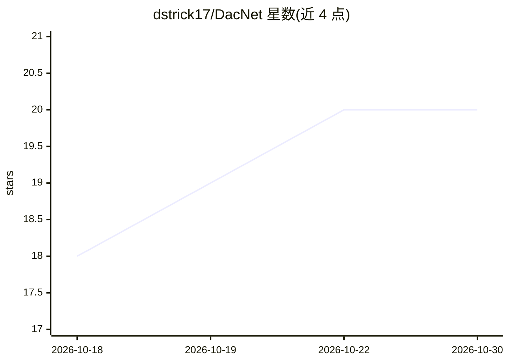

# dstrick17/DacNet

⭐ 20 · Python · MIT · 推送 2026-10-26 · [GitHub](https://github.com/dstrick17/DacNet) · [官网](https://arxiv.org/abs/2505.06646v1) · 组织维护

**复现并扩展 CheXNet 的胸片疾病分类项目（DACNet）**

包含两部分：在 NIH ChestX-ray14 数据集（约 11.2 万张胸片、14 种疾病标签）上复现 CheXNet 的 DenseNet-121 多标签分类基线，以及针对类别不平衡设计的扩展模型 DACNet（DenseNet-121 骨干、Focal Loss、逐类阈值调优）。采用患者级 70/10/20 划分，AUROC 为主指标、F1 为次要分析。面向可复现科研场景，提供训练脚本、Kaggle GPU 冒烟测试与 ReScience C 论文；限制包括依赖 NIH 标签（非专家标注）与 GPU 训练时间。

## 筛选速览

| 维度 | 判定 | 备注 |
|---|---|---|
| AI 角色 | `ai-native` | 本体是模型或模型工具 |
| 许可风险 | `permissive` | MIT |
| 部署形态 | `library` | 以包/库形式分发 |
| 模型依赖 | — | README 未给出锁定关系 |
| 硬件要求 | — | 无带数字的原话,不猜 |
| 安装摩擦 | `medium` | 含编译或系统依赖之一 |
| 成熟度 | — | 结构信号不足 |

## 能力要点

- CheXNet DenseNet-121 复现：14 种胸内疾病多标签分类，AUROC 为主指标
- DACNet 扩展：Focal Loss 与逐类阈值调优，宏平均 AUROC 0.8474、宏 F1 0.3414
- 患者级数据划分与验证集阈值化 F1 次要分析
- 提供 Kaggle GPU 冒烟测试与可复现性产物（reproducibility/、论文 PDF）

## 适用场景

- 在 ChestX-ray14 上复现 CheXNet 基线并核对结果
- 研究类别不平衡下胸片多标签分类的损失与阈值策略
- 作为可复现深度学习实验的参考工程结构

## 场景标签

`目标检测` · 领域:感知与多模态

## 证据(README 行号)

> L4: 1. a **reproduction** of the CheXNet DenseNet-121 model on the NIH ChestX-ray14 dataset, and
> L5: 2. an **extension (DACNet)** designed to improve performance under class imbalance.
> L16: - Multi-label classification (14 thoracic diseases)

## 星数曲线

2026-10-18 18 → 2026-10-30 20（+2）

---
*卡片 v1 · prompt 1.4 · 生成 2026-10-28 · 置信度 mid · 依据 README sha `cb1f4278d935` · [字段定义](../../DATASET.md)*
