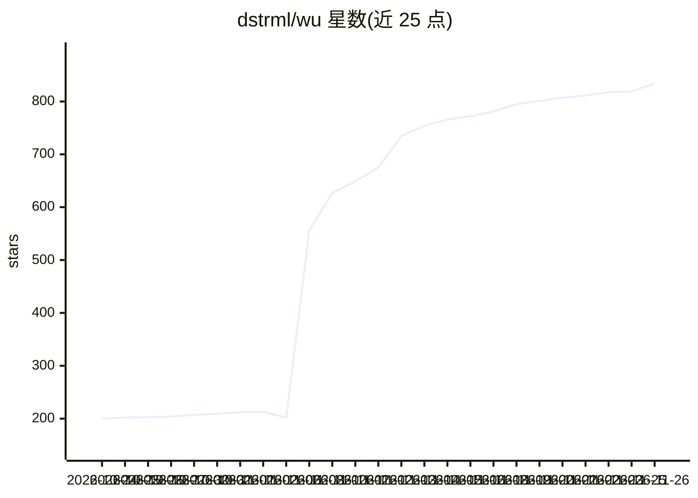

# dstrml/wu

⭐ 834 · Rust · NOASSERTION · 推送 2026-11-25 · [GitHub](https://github.com/dstrml/wu) · [官网](https://wu.dstrml.org) · 个人维护 · 中文 README

**内置编码 agent 的 Rust 原生代码编辑器**

用 Rust 编写的原生代码编辑器与 agent 工作区，是 Zed 的 fork。无 Electron/webview，GPU 渲染，README 声明内存占用低于 VS Code 与 Zed。内置对 Claude Code、Codex、OpenCode、Antigravity 四个编码 agent 的支持，无账号与遥测。通过安装脚本或安装包部署，覆盖 macOS（Intel/Apple Silicon）、Windows、Linux（x86-64/AArch64）。许可为 GPL-3.0-or-later，部分组件为 Apache-2.0。

## 筛选速览

| 维度 | 判定 | 备注 |
|---|---|---|
| AI 角色 | `ai-enhanced` | 去掉 AI 部分产品仍成立 |
| 许可风险 | `none` | NOASSERTION |
| 部署形态 | `None` |  |
| 模型依赖 | — | README 未给出锁定关系 |
| 硬件要求 | — | 无带数字的原话,不猜 |
| 安装摩擦 | `low` | 无编译、无系统依赖或容器化 |
| 成熟度 | — | 结构信号不足 |

## 能力要点

- 内置支持 Claude Code、Codex、OpenCode、Antigravity 四个编码 agent
- 无 Electron/webview，GPU 渲染的 Rust 原生实现
- 无账号与遥测，README 声明不发送使用数据
- 提供 macOS/Windows/Linux 五种平台的安装包

## 适用场景

- 在本地编辑器内直接调用编码 agent 完成编码任务
- 在无网络遥测环境下使用带 agent 的代码编辑器
- 需要原生（非 Electron）编辑器的开发者工作流

## 场景标签

`编码 Agent` · 领域:编码与开发

## 证据(README 行号)

> L9: Wu is a fast, native code editor written in Rust, with a clean, modern design and coding agents built in. The name c
> L15: - 👾 **Coding agents included.** Built-in support for Claude Code, Codex, OpenCode, and Antigravity.

## 星数曲线

2026-10-24 200 → 2026-11-26 834（+634）

---
*卡片 v1 · prompt 1.4 · 生成 2026-11-25 · 置信度 high · 依据 README sha `19cb12f5180e` · [字段定义](../../DATASET.md)*
