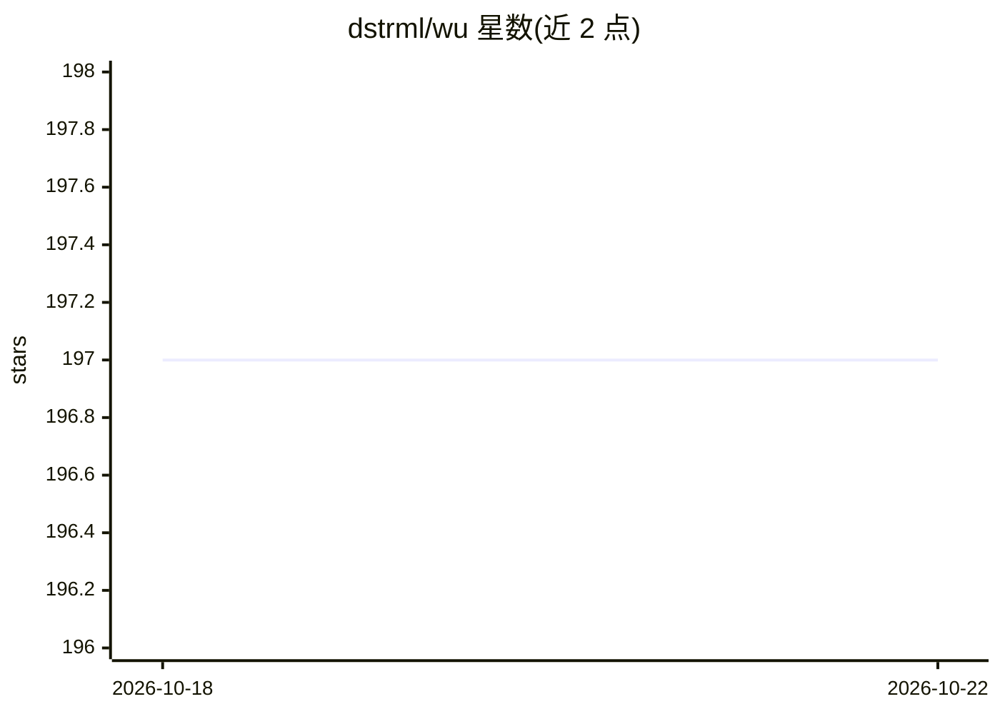

# dstrml/wu

⭐ 200 · Rust · NOASSERTION · 推送 2026-10-22 · [GitHub](https://github.com/dstrml/wu) · [官网](https://wu.dstrml.org) · 个人维护

**Rust 编写的原生代码编辑器，内置 coding agent 工作区**

Wu 是用 Rust 编写的原生代码编辑器，是 Zed 的 fork 但已大幅分化。不使用 Electron 或 webview，内存占用据其基准测试低于 VS Code 和 Zed。内置 Claude Code、Codex、OpenCode 三种 coding agent 支持，无账号登录与遥测。以 GPL-3.0-or-later 许可（部分组件 Apache-2.0），提供 macOS/Linux 安装脚本、Windows 安装包及多平台手动下载，也可按 Zed 方式从源码构建。

## 筛选速览

| 维度 | 判定 | 备注 |
|---|---|---|
| AI 角色 | `ai-enhanced` | 去掉 AI 部分产品仍成立 |
| 许可风险 | `none` | NOASSERTION |
| 部署形态 | `None` |  |
| 模型依赖 | — | README 未给出锁定关系 |
| 硬件要求 | — | 无带数字的原话,不猜 |
| 安装摩擦 | `low` | 无编译、无系统依赖或容器化 |
| 成熟度 | — | 结构信号不足 |

## 能力要点

- 原生实现，无 Electron 或 webview
- 内置 Claude Code、Codex、OpenCode 支持
- 无账号要求、无遥测
- Zed 的 fork，共享其许可证体系

## 适用场景

- 在轻量原生编辑器中进行日常代码编辑
- 在编辑器内直接使用 Claude Code 等 coding agent
- 需要无登录、无遥测环境的编辑工作

## 场景标签

`编码 Agent` · 领域:编码与开发

## 证据(README 行号)

> L3:  The fast, native code editor and agent workspace.
> L13: - 👾 **Coding agents included.** Built-in support for Claude Code, Codex, and OpenCode.

## 星数曲线

2026-10-18 197 → 2026-10-22 197（+0）

---
*卡片 v1 · prompt 1.4 · 生成 2026-10-22 · 置信度 high · 依据 README sha `baadf37d0b66` · [字段定义](../../DATASET.md)*
