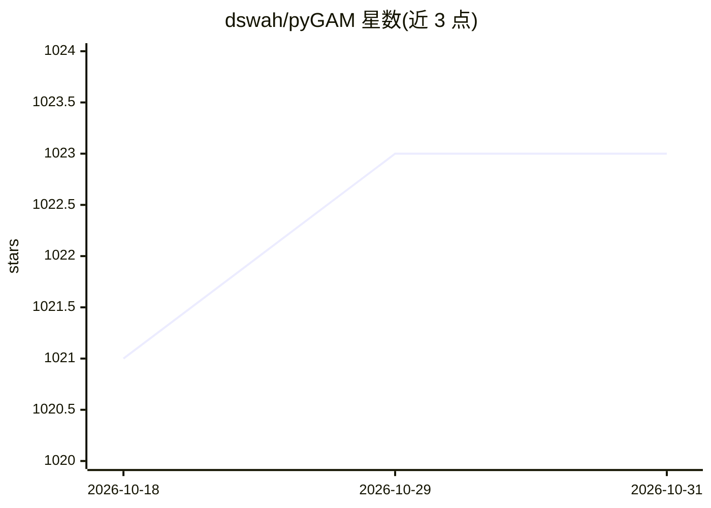

# dswah/pyGAM

⭐ 1,023 · Python · Apache-2.0 · 推送 2026-04-21 · [GitHub](https://github.com/dswah/pyGAM) · [官网](https://pygam.readthedocs.io) · 个人维护

**Python 广义可加模型（GAM）建模库：拟合可解释非线性模型**

用于构建广义可加模型的 Python 包，采用惩罚性 B 样条构造特征函数，自动建模非线性关系，同时保持可加性与可解释性，可逐变量考察其对目标的影响。API 面向 scikit-learn 或 scipy 用户设计，强调模块化与性能；大部分计算为线性代数运算，可选安装加速版 numpy/scipy。以 pip 安装的 Python 库形式提供，附官方文档、教程与 Zenodo 引用条目，Apache 2.0 许可。

## 筛选速览

| 维度 | 判定 | 备注 |
|---|---|---|
| AI 角色 | `ai-native` | 本体是模型或模型工具 |
| 许可风险 | `permissive` | Apache-2.0 |
| 部署形态 | `library` | 以包/库形式分发 |
| 模型依赖 | — | README 未给出锁定关系 |
| 硬件要求 | — | 无带数字的原话,不猜 |
| 安装摩擦 | `low` | 无编译、无系统依赖或容器化 |
| 成熟度 | — | 结构信号不足 |

## 能力要点

- 惩罚性 B 样条自动建模非线性关系
- 可加性使各特征对目标的影响可单独考察
- API 设计面向 scikit-learn / scipy 用户
- 支持多种链接函数的广义模型框架

## 适用场景

- 训练可解释的回归/分类模型并逐特征解释影响
- 科研或数据分析中替代手工特征变换拟合非线性关系
- 构建需控制过拟合并保留可解释性的预测模型

## 场景标签

 · 领域:机器学习/统计建模

## 证据(README 行号)

> L7: `pyGAM` is a package for building Generalized Additive Models in Python, with an emphasis on modularity and performa
> L54: The feature functions $f_i$ are built using **penalized B-splines**, which allow us to **automatically model non-li

## 星数曲线

2026-10-18 1,021 → 2026-10-31 1,023（+2）

---
*卡片 v1 · prompt 1.4 · 生成 2026-10-21 · 置信度 high · 依据 README sha `5ba4a6a4a772` · [字段定义](../../DATASET.md)*
