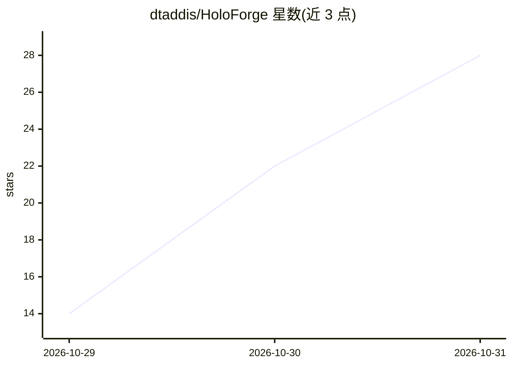

# dtaddis/HoloForge

⭐ 28 · Python · Apache-2.0 · 推送 2026-10-30 · [GitHub](https://github.com/dtaddis/HoloForge) · 个人维护

**本地将单张照片转为 Looking Glass 光场全息图的转换器**

面向 Looking Glass 光场显示器用户的本地工具：把一张照片交给运行在本地 ComfyUI 中的 MiniMax H3 视频模型，用其首尾帧模式与 360° 环绕 LoRA 生成围绕定格场景的相机轨道视频，再从 48 个视角打包成 quilt 全息图；连接 Looking Glass Portrait 时可直接复现其透镜着色器并编码 HEVC 加入设备播放列表。提供 Web 界面与命令行两种使用方式，Windows/Linux/macOS 均通过安装脚本部署，模型约 34 GB。声明为早期原型，非 Looking Glass Factory 官方产品；照片视角之外的内容由模型生成，属解释性内容。

## 筛选速览

| 维度 | 判定 | 备注 |
|---|---|---|
| AI 角色 | `ai-native` | 本体是模型或模型工具 |
| 许可风险 | `permissive` | Apache-2.0 |
| 部署形态 | `None` |  |
| 模型依赖 | local-ok | 支持本地模型 |
| 硬件要求 | — | 无带数字的原话,不猜 |
| 安装摩擦 | `medium` | 含编译或系统依赖之一 |
| 成熟度 | `idea` | |

## 能力要点

- MiniMax H3 FL2VA + 360° 环绕 LoRA 生成多视角轨道而非深度图扭曲
- 48 视角 quilt 输出，支持 Portrait/lg16/musubi 三种显示器预设
- 独立复现 Looking Glass Studio 的 lenticular 着色器与 HEVC 编码，无需 Studio
- Web 应用与 CLI 双入口，H3 片段缓存复用使改参数后约一分钟出图

## 适用场景

- 把自己的老照片转成可裸眼观看的 Looking Glass 全息图
- 批量转换照片文件夹并直接推送到 Portrait 播放列表
- 在本地 ComfyUI 环境中离线生成光场内容，不依赖云端服务

## 场景标签

`视频生成` · 领域:内容生成

## 证据(README 行号)

> L4: PC. It asks the MiniMax H3 video model,
> L5: running in your local ComfyUI, to fly a camera round the frozen moment in the photo, then
> L7: photo over a depth map. With a Looking Glass Portrait plugged in, results go straight onto

## 星数曲线

2026-10-29 14 → 2026-10-31 28（+14）

---
*卡片 v1 · prompt 1.4 · 生成 2026-10-30 · 置信度 high · 依据 README sha `4069d57c159f` · [字段定义](../../DATASET.md)*
