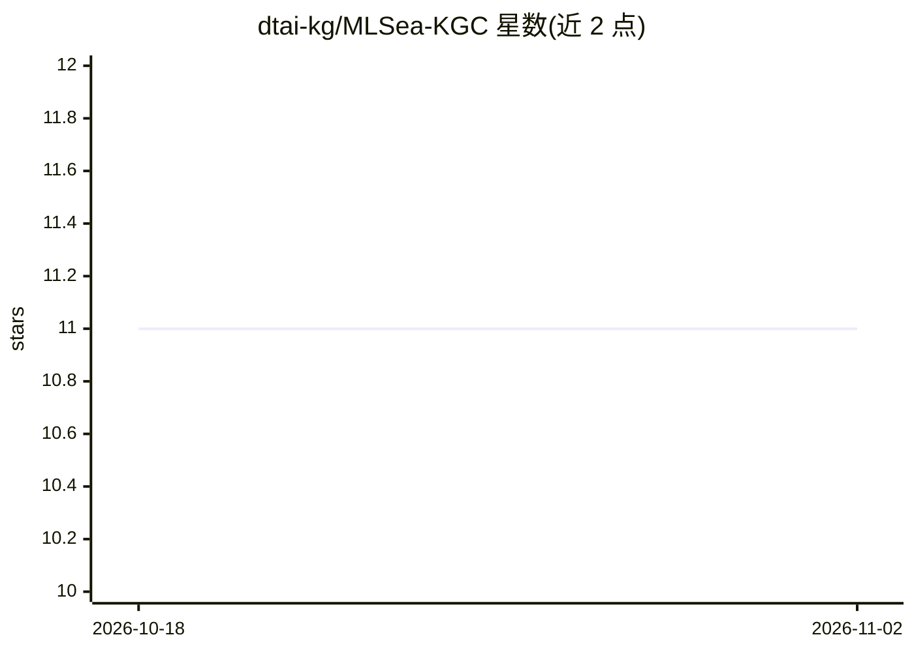

# dtai-kg/MLSea-KGC

⭐ 11 · Python · Apache-2.0 · 推送 2026-03-18 · [GitHub](https://github.com/dtai-kg/MLSea-KGC) · [官网](http://w3id.org/mlsea) · 组织维护

**构建机器学习知识图谱 MLSea-KG 的资源代码与 RML 映射**

包含构建 MLSea-KG（超 14.4 亿 RDF 三元组的机器学习知识图谱）的源代码与 RML 映射：从 OpenML API、Meta Kaggle CSV、Papers with Code dump 采集数据，经预处理与采样后以声明式 RML 映射（含 YARRRML 序列化）生成 RDF 三元组。覆盖数据集、任务、实现与超参、实验执行与评估结果、算法、论文、模型等实体。图谱可通过 SPARQL endpoint 查询，快照存于 Zenodo；数据源本身不在仓库内。

## 筛选速览

| 维度 | 判定 | 备注 |
|---|---|---|
| AI 角色 | `ai-knowledge` | 知识聚合/清单类 |
| 许可风险 | `permissive` | Apache-2.0 |
| 部署形态 | `library` | 以包/库形式分发 |
| 模型依赖 | — | README 未给出锁定关系 |
| 硬件要求 | — | 无带数字的原话,不猜 |
| 安装摩擦 | `low` | 无编译、无系统依赖或容器化 |
| 成熟度 | — | 结构信号不足 |

## 能力要点

- 从 OpenML、Kaggle、Papers with Code 三源采集并整合 ML 元数据
- 声明式 RML 映射生成 RDF，含 YARRRML 序列化
- MLSea-KG 超 14.4 亿 RDF 三元组，可通过 SPARQL endpoint 查询
- 提供 SPARQL 示例查询目录

## 适用场景

- 复现或增量构建 MLSea 知识图谱
- 通过 SPARQL 查询机器学习数据集、算法与实验结果元数据
- 研究跨平台机器学习元数据的语义整合方法

## 场景标签

`知识图谱` · 领域:知识与检索

## 证据(README 行号)

> L5: This repository contains source code and RML mappings used for creating **MLSea-KG**, a **declaratively** constructe
> L23: Resource code directory contains resource code used for **collecting**, **pre-processing**, **sampling** and **decl
> L32: **MLSea-KG** is accessible through our SPARQL endpoint. The sparql_examples folder contains example queries for tra

## 星数曲线

2026-10-18 11 → 2026-11-02 11（+0）

---
*卡片 v1 · prompt 1.4 · 生成 2026-11-02 · 置信度 mid · 依据 README sha `762e021b34eb` · [字段定义](../../DATASET.md)*
