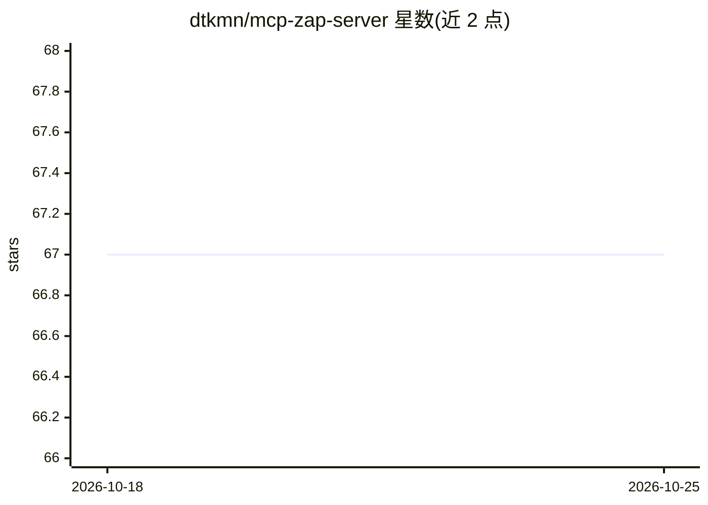

# dtkmn/mcp-zap-server

⭐ 67 · Java · Apache-2.0 · 推送 2026-10-25 · [GitHub](https://github.com/dtkmn/mcp-zap-server) · [官网](https://danieltse.org/mcp-zap-server/) · 个人维护

**让 AI agent 安全操作 ZAP 扫描器的自托管 MCP 服务器**

通过 MCP over Streamable HTTP 向 AI agent 暴露 OWASP ZAP 安全扫描能力：提供 spider、主动/被动扫描、OpenAPI 导入、findings 与报告等引导式工具，另有可选的低层 expert ZAP 控制。面向需要在 agent 工作流中集成 Web 安全扫描的开发者。机制上以 API key（默认）或 JWT 认证、工具作用域、运行时策略包、限流与审计事件构成操作员控制层；Docker Compose 部署时以 ZAP sidecar 配套运行，另有 Helm 图表用于 Kubernetes。URL 校验默认阻断内网与 localhost 目标。0.17.1 镜像发布需在 GitHub Releases 自行核实。

## 筛选速览

| 维度 | 判定 | 备注 |
|---|---|---|
| AI 角色 | `ai-ecosystem` | LLM/agent 周边工具 |
| 许可风险 | `permissive` | Apache-2.0 |
| 部署形态 | `self-host` | docker 或自建部署 |
| 模型依赖 | — | README 未给出锁定关系 |
| 硬件要求 | — | 无带数字的原话,不猜 |
| 安装摩擦 | `low` | 无编译、无系统依赖或容器化 |
| 成熟度 | `idea` | |

## 能力要点

- MCP over Streamable HTTP 暴露引导式 ZAP 工具（爬取/主动/被动扫描/报告）
- API key 与 JWT 认证、工具作用域、策略包、限流与审计事件等操作员控制
- Docker Compose 本地部署（ZAP sidecar）与 Helm/Kubernetes、EKS starter 部署路径
- 默认安全姿态：端口绑定 loopback、URL 校验阻断内网目标、请求体大小上限

## 适用场景

- 在 AI agent 会话中执行受控的 Web 应用安全扫描并生成报告
- 把 ZAP 扫描接入 MCP 客户端工作流替代胶水脚本
- 团队自托管部署带认证与审计的安全扫描服务

## 场景标签

`网络安全` · 领域:学习与行业

## 证据(README 行号)

> L14: `mcp-zap-server` exposes ZAP through MCP over streamable HTTP so agentic tools can run operator-controlled security
> L18: - **safe agentic scanning** with guided defaults for spider, active scan, passive scan, API imports, findings, and 
> L255:   Client["Your MCP Client"] -->|"MCP over Streamable HTTP"| MCP["MCP ZAP Server"]

## 星数曲线

2026-10-18 67 → 2026-10-25 67（+0）

---
*卡片 v1 · prompt 1.4 · 生成 2026-10-24 · 置信度 high · 依据 README sha `13502ccf9200` · [字段定义](../../DATASET.md)*
