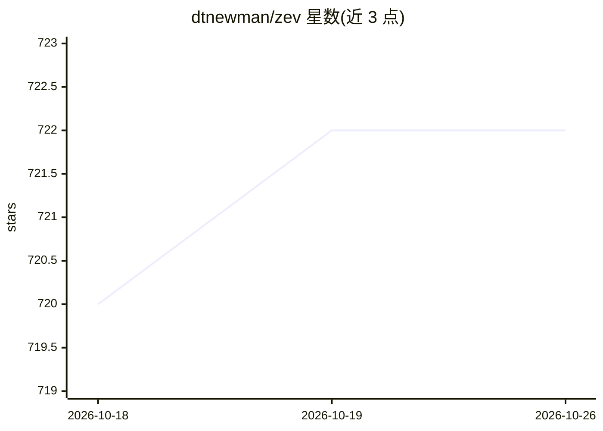

# dtnewman/zev

⭐ 722 · Python · MIT · 推送 2026-06-17 · [GitHub](https://github.com/dtnewman/zev) · 个人维护

**用自然语言查终端命令的 CLI 工具，基于 LLM 生成命令**

Zev 是一个命令行工具，用户输入自然语言描述想做的事，工具调用 LLM 生成对应终端命令，支持交互模式与直接查询两种方式。支持的 LLM 提供方包括 OpenAI、Google Gemini、Ollama（可本地运行）、Azure OpenAI，通过 zev --setup 配置 API key 与模型。带剪贴板复制功能（Linux 需额外安装 xclip/xsel/wl-clipboard），并尝试对危险命令给出警示，但 README 声明 LLM 生成不保证全部拦截。以 Homebrew（macOS）与 pipx（Linux）安装。

## 筛选速览

| 维度 | 判定 | 备注 |
|---|---|---|
| AI 角色 | `ai-native` | 本体是模型或模型工具 |
| 许可风险 | `permissive` | MIT |
| 部署形态 | `library` | 以包/库形式分发 |
| 模型依赖 | local-ok | 支持本地模型 |
| 硬件要求 | — | 无带数字的原话,不猜 |
| 安装摩擦 | `low` | 无编译、无系统依赖或容器化 |
| 成熟度 | — | 结构信号不足 |

## 能力要点

- 自然语言转终端命令，支持交互模式与直接查询
- 支持 OpenAI、Google Gemini、Ollama、Azure OpenAI 四种提供方
- 通过 Ollama 可全本地运行
- 危险命令提示与剪贴板复制功能

## 适用场景

- 忘记命令语法时用自然语言快速查询
- 不熟悉某任务对应命令时让 LLM 给出候选命令
- 本地 Ollama 离线环境下查询命令

## 场景标签

`代码生成` · 领域:编码与开发

## 证据(README 行号)

> L6: Zev helps you remember (or discover) terminal commands using natural language.
> L26: - **Note:** This project runs on top of LLM APIs like OpenAI, Google's Gemini, or Ollama.

## 星数曲线

2026-10-18 720 → 2026-10-26 722（+2）

---
*卡片 v1 · prompt 1.4 · 生成 2026-10-22 · 置信度 high · 依据 README sha `9ad4d41f818f` · [字段定义](../../DATASET.md)*
