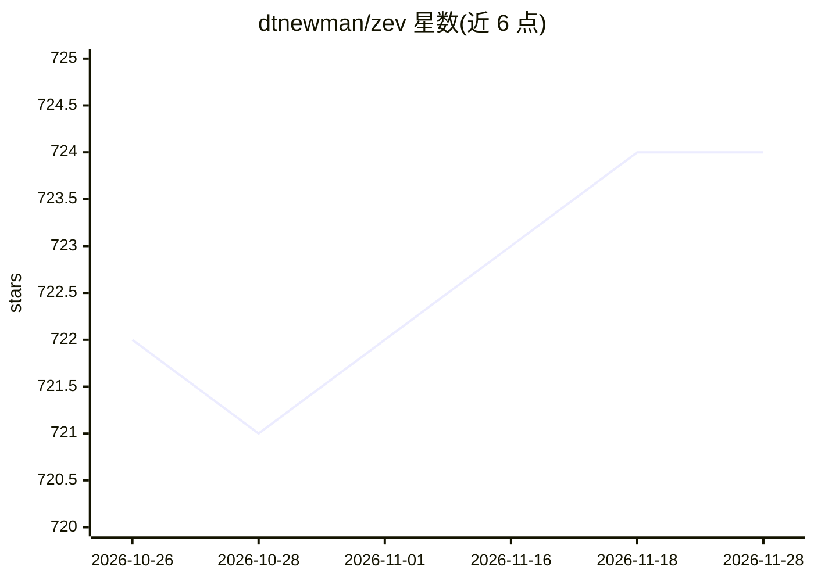

# dtnewman/zev

⭐ 724 · Python · MIT · 推送 2026-11-24 · [GitHub](https://github.com/dtnewman/zev) · 个人维护

**CLI 工具：用自然语言查回终端命令**

Zev 是一个终端 CLI 工具，用户以自然语言描述想做的事，工具调用 LLM 生成对应 shell 命令，支持交互模式与直接查询两种方式。提供危险命令警告提示，但不保证全部拦截。运行依赖 LLM API 后端，通过 zev --setup 配置 provider 与密钥；支持 OpenAI、Gemini、Ollama、Azure OpenAI、Anthropic 五种后端，其中 Ollama 可完全本地运行。macOS 经 Homebrew 安装，Linux 经 pipx 安装。Linux 下剪贴板功能需 xclip/xsel/wl-clipboard。

## 筛选速览

| 维度 | 判定 | 备注 |
|---|---|---|
| AI 角色 | `ai-native` | 本体是模型或模型工具 |
| 许可风险 | `permissive` | MIT |
| 部署形态 | `library` | 以包/库形式分发 |
| 模型依赖 | local-ok | 支持本地模型 |
| 硬件要求 | — | 无带数字的原话,不猜 |
| 安装摩擦 | `low` | 无编译、无系统依赖或容器化 |
| 成熟度 | — | 结构信号不足 |

## 能力要点

- 自然语言输入生成终端命令，含交互与直查两种模式
- 支持 5 种 LLM 后端，可随时用 zev --setup 切换
- Ollama 后端支持完全本地运行
- 内置危险命令警告机制

## 适用场景

- 忘记某个 shell 命令时用自然语言查回
- 不熟悉终端操作时发现新命令
- 本地通过 Ollama 离线生成命令

## 场景标签

`代码生成` · 领域:编码与开发

## 证据(README 行号)

> L6: Zev helps you remember (or discover) terminal commands using natural language.
> L26: - **Note:** This project runs on top of LLM APIs like OpenAI, Google's Gemini, or Ollama.
> L61: ⚠️ Commands are generated by LLMs. While the tool attempts to flag dangerous commands, it may not always do so. Use

## 星数曲线

2026-10-26 722 → 2026-11-28 724（+2）

---
*卡片 v1 · prompt 1.4 · 生成 2026-11-26 · 置信度 high · 依据 README sha `4e91069b81ad` · [字段定义](../../DATASET.md)*
