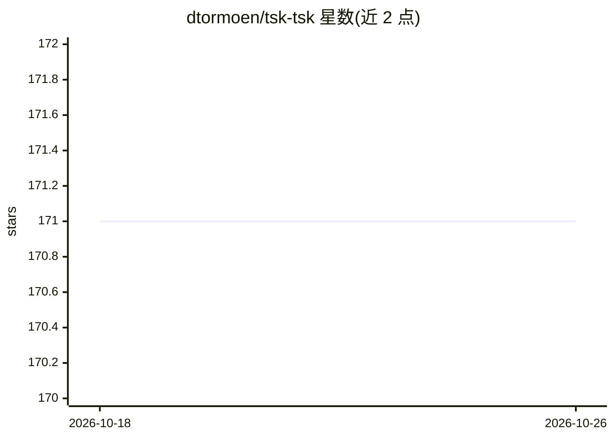

# dtormoen/tsk-tsk

⭐ 171 · Rust · MIT · 推送 2026-07-29 · [GitHub](https://github.com/dtormoen/tsk-tsk) · 个人维护

**将开发任务委托给沙箱容器内 AI 编码代理的自动化工具**

用 Rust 编写的 CLI 工具 `tsk`：把开发任务通过模板指派给 Claude Code 或 Codex 编码代理，在文件系统与网络隔离的 Docker/Podman 容器中以 YOLO 模式并行异步执行，完成后把工作成果作为分支取回原仓库供人工审查。工具自动检测项目工具链并构建容器镜像，通过网络代理 sidecar 强制域名白名单；提供交互式沙箱 shell、一次性自主任务、任务队列服务器（含 TUI 面板）与任务链式执行。面向使用编码代理的开发者，要求本机具备 Rust 工具链、容器运行时与 Git。

## 筛选速览

| 维度 | 判定 | 备注 |
|---|---|---|
| AI 角色 | `ai-ecosystem` | LLM/agent 周边工具 |
| 许可风险 | `permissive` | MIT |
| 部署形态 | `self-host` | docker 或自建部署 |
| 模型依赖 | locked-api |  |
| 硬件要求 | — | 无带数字的原话,不猜 |
| 安装摩擦 | `low` | 无编译、无系统依赖或容器化 |
| 成熟度 | — | 结构信号不足 |

## 能力要点

- 代理在隔离容器中运行，经代理 sidecar 强制域名白名单
- 自动检测工具链并构建容器镜像，多数项目免配置
- 任务模板、队列服务器与任务链（--parent）支持并行执行
- 支持 Claude Code 与 Codex，可指定多代理并行对比

## 适用场景

- 并行让多个 AI 编码代理在不同隔离沙箱中处理开发任务
- 以隔离环境安全地让代理以自主模式修改代码
- 用任务模板与队列自动化处理 issue、文档、代码评审等重复性任务

## 场景标签

`编码 Agent` · 领域:编码与开发

## 证据(README 行号)

> L3: Delegate development `tsk` tasks to YOLO mode AI agents running in sandbox containers. `tsk` auto-detects your toolc
> L19: Supports Claude Code and Codex coding agents. Docker and Podman container runtimes.
> L30: - One of the supported coding agents:

## 星数曲线

2026-10-18 171 → 2026-10-26 171（+0）

---
*卡片 v1 · prompt 1.4 · 生成 2026-10-22 · 置信度 mid · 依据 README sha `f4c0783738f8` · [字段定义](../../DATASET.md)*
