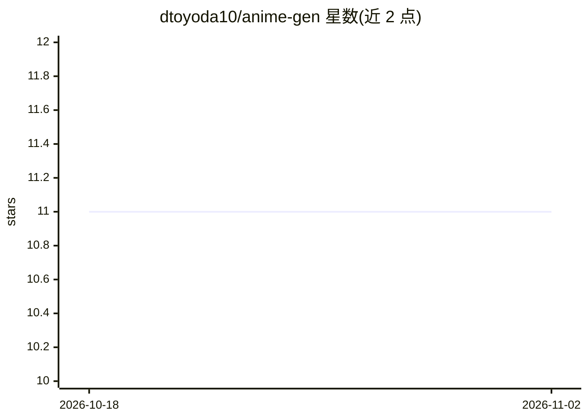

# dtoyoda10/anime-gen

⭐ 11 · TypeScript · MIT · 推送 2026-06-29 · [GitHub](https://github.com/dtoyoda10/anime-gen) · 个人维护

**用 AI 从文本或图像生成动漫风格角色与插画**

基于 Next.js 的 Web 应用，通过深度学习模型（README 提及 GAN 与扩散模型）将素描、文字描述或真实图像生成动漫风格角色、背景与插画。图像生成接入 Replicate API，使用 Prisma + Postgres/Supabase 存储数据、CloudFlare R2 存储图像、Clerk 处理用户登录，前端由 TailwindCSS 构建。面向艺术家、内容创作者与动漫爱好者。部署需配置环境变量并连接数据库，通过 npm run dev 本地运行。

## 筛选速览

| 维度 | 判定 | 备注 |
|---|---|---|
| AI 角色 | `ai-native` | 本体是模型或模型工具 |
| 许可风险 | `permissive` | MIT |
| 部署形态 | `library` | 以包/库形式分发 |
| 模型依赖 | — | README 未给出锁定关系 |
| 硬件要求 | — | 无带数字的原话,不猜 |
| 安装摩擦 | `low` | 无编译、无系统依赖或容器化 |
| 成熟度 | — | 结构信号不足 |

## 能力要点

- 从素描、文字描述或真实图像生成动漫风格作品
- 图像生成通过 Replicate API 实现
- 基于 Next.js 的 Web 应用，含用户登录与图像存储（Clerk / CloudFlare R2）

## 适用场景

- 为动漫或漫画生成角色设计
- 生成个性化社交媒体头像
- 探索不同艺术风格与配色寻找创作灵感

## 场景标签

`图像生成` · 领域:内容生成

## 证据(README 行号)

> L5: AI Anime Generator is a deep learning-powered tool that creates high-quality anime-style artwork from sketches, desc
> L29: - Replicate - Image Generation

## 星数曲线

2026-10-18 11 → 2026-11-02 11（+0）

---
*卡片 v1 · prompt 1.4 · 生成 2026-11-02 · 置信度 mid · 依据 README sha `a85e60b6c64c` · [字段定义](../../DATASET.md)*
