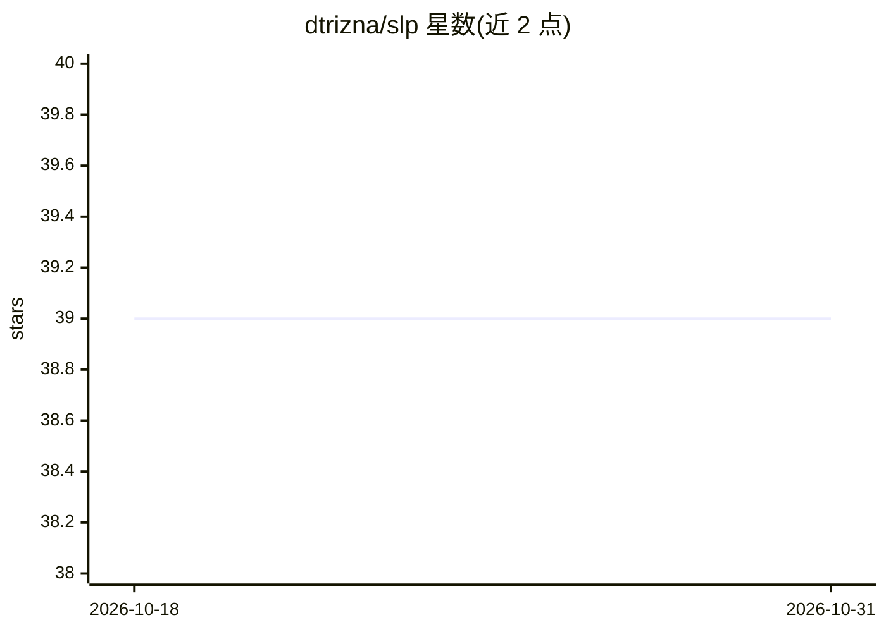

# dtrizna/slp

⭐ 39 · Python · MIT · 推送 2025-11-26 · [GitHub](https://github.com/dtrizna/slp) · 个人维护

**Shell 命令分词与编码库：为 ML 模型预处理 bash 命令**

提供 ShellTokenizer 与 ShellEncoder 类，解析 Unix/Linux shell 命令（如 auditd 日志或 bash history），输出可供机器学习模型使用的 TF-IDF 特征，基于 bashlex 做分词并处理异常情况。面向安全研究人员与 ML 开发者，附 CAMLIS 2021 论文，含恶意/良性命令分类评测（XGBoost）。README 自述为 pre-alpha 概念验证，分词较耗时，并给出更快替代方案；通过 Docker Hub 提供 Docker 镜像。

## 筛选速览

| 维度 | 判定 | 备注 |
|---|---|---|
| AI 角色 | `ai-ecosystem` | LLM/agent 周边工具 |
| 许可风险 | `permissive` | MIT |
| 部署形态 | `self-host` | docker 或自建部署 |
| 模型依赖 | — | README 未给出锁定关系 |
| 硬件要求 | — | 无带数字的原话,不猜 |
| 安装摩擦 | `low` | 无编译、无系统依赖或容器化 |
| 成熟度 | `idea` | |

## 能力要点

- ShellTokenizer/ShellEncoder 将原始 shell 命令转为 ML 特征
- 在 nl2bash 与渗透测试恶意样本上评测分类效果
- 基于 bashlex 扩展处理问题用例
- Docker Hub 提供镜像

## 适用场景

- 把 bash history 或 auditd 日志编码后输入 ML 模型训练
- 构建恶意命令检测分类器
- 对 shell 命令语料做探索性数据分析

## 场景标签

`网络安全` `数据分析` · 领域:效率与自动化

## 证据(README 行号)

> L11: SLP provides a tokenization and encoder classes for parsing of Unix/Linux shell commands, so raw commands (e.g. fro
> L74: :warning: This is Proof-of-Concept (PoC) realization, pre-alpha software. Tokenization is comparatively time consum

## 星数曲线

2026-10-18 39 → 2026-10-31 39（+0）

---
*卡片 v1 · prompt 1.4 · 生成 2026-10-25 · 置信度 high · 依据 README sha `52d5b0d94d13` · [字段定义](../../DATASET.md)*
