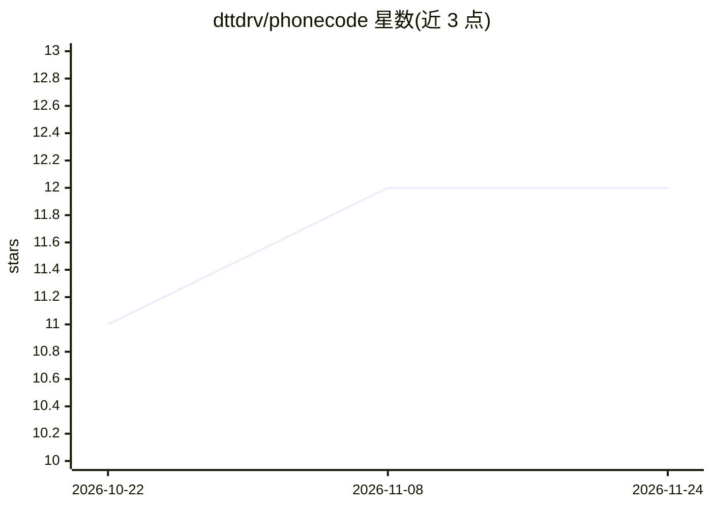

# dttdrv/phonecode

⭐ 12 · Kotlin · Apache-2.0 · 推送 2026-10-24 · [GitHub](https://github.com/dttdrv/phonecode) · [官网](https://dttdrv.xyz/phonecode) · 个人维护

**在 Android 手机本地运行编码 agent 的应用**

PhoneCode 是在 Android 设备上运行 agent 循环的编码代理应用：在本项目工作区内读取、写入和编辑文件，本地运行 Git 与捆绑的 Alpine Linux 环境，支持网页搜索，并可接入用户选择的多家模型提供商。无通用后端、遥测或强制账号，API 密钥存于 Android Keystore。提供动作审批、MCP 服务器、技能管理与会话恢复机制。构建需 JDK 21 与 Android SDK，从源码用 Gradle 编译；当前本地运行时为 sideload 原型，Play 发布暂被阻塞。

## 筛选速览

| 维度 | 判定 | 备注 |
|---|---|---|
| AI 角色 | `ai-ecosystem` | LLM/agent 周边工具 |
| 许可风险 | `permissive` | Apache-2.0 |
| 部署形态 | `None` |  |
| 模型依赖 | locked-api |  |
| 硬件要求 | — | 无带数字的原话,不猜 |
| 安装摩擦 | `medium` | 含编译或系统依赖之一 |
| 成熟度 | `idea` | |

## 能力要点

- 设备端 agent 循环：文件工具、Git、todo、子 agent、MCP 服务器与技能热重载
- 多提供商接入：Anthropic、OpenAI、OpenRouter、DeepSeek 等，可经 providers.json 热更新
- ChatGPT 登录（Codex，OAuth + PKCE）可复用付费 ChatGPT 计划，无需 API key
- 崩溃安全会话：工具检查点、原子本地存储与显式恢复

## 适用场景

- 在 Android 手机上对本地项目进行 AI 辅助读写与 Git 操作
- 通过私有模型端点在移动设备上运行编码 agent
- 用 MCP 服务器和自定义技能扩展移动端 agent 能力

## 场景标签

`编码 Agent` · 领域:编码与开发

## 证据(README 行号)

> L5:  A private, native coding agent that runs entirely on your Android phone.
> L50: - **Providers**: OpenCode Zen and Go, Anthropic, OpenAI, OpenRouter, Google, xAI, DeepSeek,

## 星数曲线

2026-10-22 11 → 2026-11-24 12（+1）

---
*卡片 v1 · prompt 1.4 · 生成 2026-11-18 · 置信度 high · 依据 README sha `0d3d4d739b25` · [字段定义](../../DATASET.md)*
