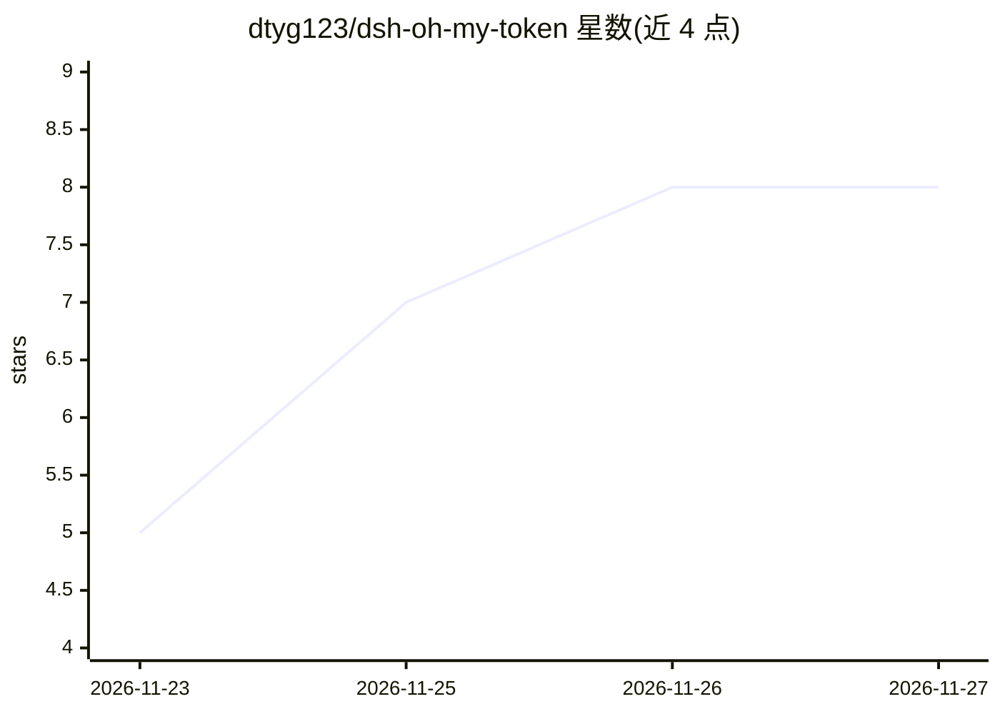

# dtyg123/dsh-oh-my-token

⭐ 8 · JavaScript · NOASSERTION · 推送 2026-11-22 · [GitHub](https://github.com/dtyg123/dsh-oh-my-token) · 个人维护 · 中文 README

**为 DeepSeek Harness 省 token 的插件：改写工具输出再入提示词**

DeepSeek Harness 的插件，在工具结果写入日志前完成改写，使模型看到的字节与持久化记录一致。机制包括：按命令与输出形状压缩（pytest/git/tsc/包管理器安装日志等命令过滤器，未命中时按内容形状做 RTK 式结构压缩）、把超大 read 变成符号大纲的检索式读取、散文行句末标点与客套词剥离，以及超预算时的 spill store 保存与取回标记。附设置页面管理开关、预算与节省统计，提供 report/map/lint 子命令。纯 JS 实现，无二进制、零新依赖，MIT 许可，靠个人时间维护。

## 筛选速览

| 维度 | 判定 | 备注 |
|---|---|---|
| AI 角色 | `ai-ecosystem` | LLM/agent 周边工具 |
| 许可风险 | `none` | NOASSERTION |
| 部署形态 | `None` |  |
| 模型依赖 | locked-api |  |
| 硬件要求 | — | 无带数字的原话,不猜 |
| 安装摩擦 | `low` | 无编译、无系统依赖或容器化 |
| 成熟度 | — | 结构信号不足 |

## 能力要点

- 工具结果写入日志前改写，模型所见与持久化记录一致，不改写参数、不启动外部进程
- 命令过滤器 + RTK 式形状压缩 + read 符号大纲 + 散文标点/客套词剥离，各项可分别开关
- 超预算时通过 ctx.spillStore 保存全文并标记取回位置，不丢弃不可恢复文本
- 设置页面提供每项变换开关、预算配置、节省统计与落盘确认

## 适用场景

- 压缩 agent 会话中 git diff、构建日志等工具输出占用的提示词 token
- 把超大文件读取变成符号大纲以控制上下文体积
- 查看每次会话与历史的 token/字符节省明细

## 场景标签

 · 领域:LLM 基础设施/agent 工具链

## 证据(README 行号)

> L7: `dsh-oh-my-token` 是 DeepSeek Harness 插件。它在工具结果**写入日志之前**完成改写，因此模型看到的字节与持久化记录完全一致；它从不改写工具参数、从不触碰磁盘上的会话文件、也不启动任何外部进程。
> L35: dsh plugin --profile web add dsh-oh-my-token

## 星数曲线

2026-11-23 5 → 2026-11-27 8（+3）

---
*卡片 v1 · prompt 1.4 · 生成 2026-11-23 · 置信度 high · 依据 README sha `58d6c72103e2` · [字段定义](../../DATASET.md)*
