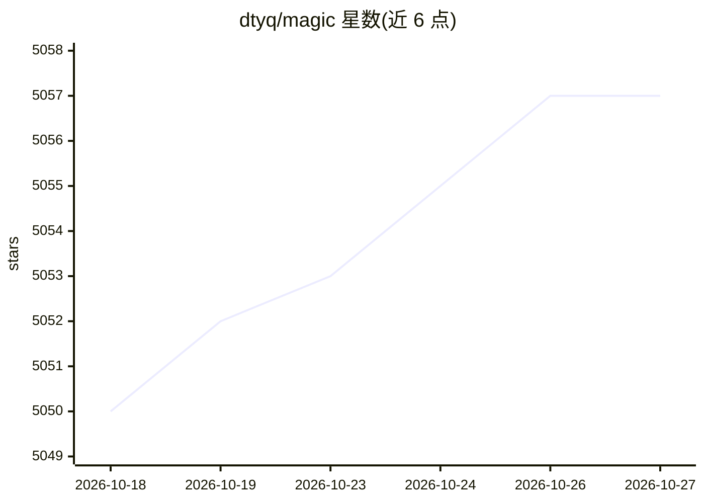

# dtyq/magic

⭐ 5,057 · TypeScript · NOASSERTION · 推送 2026-10-24 · [GitHub](https://github.com/dtyq/magic) · [官网](https://www.magicrew.ai/) · 组织维护 · 中文 README

**面向企业的开源 AI Agent 平台：数字员工+工作流+协作**

自托管的 AI Agent 平台，定位企业级部署：将 ERP/CRM/内部系统封装为可复用的'数字员工'，每个员工配备连接日历、邮件与内部系统的个人 AI 助手。机制上包含沙箱容器隔离、高风险操作人工审批流、按部门/用户/Agent 的预算上限，以及将 AI 输出渲染为 PPT/报表/看板等成品物件的渲染框架。兼容 Anthropic Skills 与 OpenClaw Skills 生态，进度可推送至企业微信/钉钉/飞书。部署需 Docker+curl，支持 macOS/Linux（Windows 尚未支持），提供云服务与企业版；许可为基于 Apache 2.0 附加限制的 Magic Open Source License。

## 筛选速览

| 维度 | 判定 | 备注 |
|---|---|---|
| AI 角色 | `ai-ecosystem` | LLM/agent 周边工具 |
| 许可风险 | `none` | NOASSERTION |
| 部署形态 | `None` |  |
| 模型依赖 | — | README 未给出锁定关系 |
| 硬件要求 | — | 无带数字的原话,不猜 |
| 安装摩擦 | `low` | 无编译、无系统依赖或容器化 |
| 成熟度 | — | 结构信号不足 |

## 能力要点

- 将内部系统封装为数字员工，个人助手按需调用专家 Agent
- 沙箱隔离 + 高风险操作人工审批 + 分级预算控制
- AI 输出直接渲染为 PPT/报表/Excel/看板等成品交付物
- 兼容 Anthropic Skills 与 OpenClaw Skills 生态

## 适用场景

- 中小企业用少量人员配合 AI 数字员工覆盖营销、客服、法务等职能
- 企业集中管理 AI 使用，控制数据边界与各部门预算
- 将 retiring 专家经验编码为可复用的领域 Agent

## 场景标签

`Agent 框架` `工作流自动化` `AI 助手` · 领域:Agent 开发

## 证据(README 行号)

> L32: Magic is built for exactly these challenges: an enterprise AI Agent platform built for **security, control, direct 
> L63: Deeply encapsulate fragmented internal systems (ERP / CRM / databases) and domain expertise into **digital employee
> L94: Fully compatible with the **Anthropic Skills ecosystem** and the **OpenClaw Skills ecosystem**. Existing tools and 

## 星数曲线

2026-10-18 5,050 → 2026-10-27 5,057（+7）

---
*卡片 v1 · prompt 1.4 · 生成 2026-10-20 · 置信度 mid · 依据 README sha `30c4bf086e85` · [字段定义](../../DATASET.md)*
